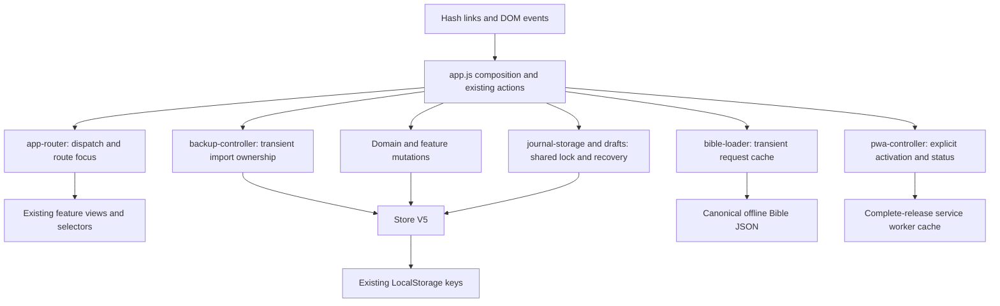

# FaithPath architecture

Current maintenance baseline: `7d24aea30bec5b0b8d43e199f3cadfc6305c1e3e`
(TREEFINAL). Phase7 changes orchestration and tooling, not the product model.

## Runtime and boundaries

FaithPath is a static Vanilla JavaScript ES-module PWA. There is no application
server, runtime package dependency, account, mandatory cloud or telemetry.

| Boundary | Responsibility / contract |
| --- | --- |
| `app.js` | Compose dependencies, shared shell/dialogs, existing feature actions and editor orchestration. Does not define a second store. Still the largest maintenance risk; split only the next changed feature. |
| `app-router.js` | Parse the existing hash grammar; dispatch the existing views; retain quiz/legacy entry identity, async render token and encoded step focus. Receives views/helpers explicitly. No persistence. |
| `backup-controller.js` | Own transient file request, import/check mode and restore session. Invalidate on close/navigation; check again after a Web Lock wait. Mutate only through existing Store. |
| `pwa-controller.js` | Own optional worker registration/status and deliberate update. Last status request owns UI; channel ports close on success/failure/timeout. No data writes. |
| `bible-loader.js` | Coalesce book requests per translation. Return original JSON; evict failed/malformed responses for retry. No storage/progress changes. |
| `store.js`, `import-validation.js` | Schema V5, legacy loading, stricter import validation, persist-before-publish, exact-byte stale-state guard, backup/restore. Existing authority is unchanged. |
| `journal-storage.js`, `drafts.js` | Shared `faithpath-journal-write` lock and durable recovery record for main/draft coordination. Deterministic mutation callbacks; preserve other tabs' drafts. |
| `journal-management.js`, `bible-notes.js` | Distinct deletion/undo semantics for personal entries versus Bible-note role. Preserve historical sources and independent reflections. |
| `domain.js`, `continuity.js`, `review-*`, `paths-*` | References, chronology, path selections and correct original/after relationships. No inferred development or faith score. |
| `bible-journey.js`, `chapter-questions.js` | Unique explored-chapter events; stable book/chapter/question identity shared by reader and collection. Merely opening a chapter does not complete it. |
| `runtime-model.js`, `story-*`, `discover-*` | Validate namespaces and canonical story/question mappings; indexed bounded discovery, story and quiz projections. No editorial rewriting. |
| `today-*`, feature `*-view.js`, `experience-view.js` | HTML presentation using escaped user content and shared UI primitives. Preserve the four themes and all existing destinations. |

## CSS and assets

Root `styles.css` and earlier feature styles remain layered beneath
`src/verbunden/{tokens,foundation,today,reader,personal,discover,system}.css`.
The build flattens these seven premium parts into one coherent stylesheet with
correct relative local-font URLs. Phase7 changes no CSS or illustration.
Global selectors and historical overrides remain technical debt; scope the next
actual visual change and verify computed styles rather than adding broad overrides.

## Build and offline data flow

`scripts/build.mjs` validates approved content and constructs the runtime model
before emitting `releases/<BUILD>/{src,data,styles.css}` plus root app/manifest,
icons, seven tree assets and **one canonical `data/bibles` copy**. Both complete
translations remain. Catalog modules use versioned data URLs; the Bible loader
uses canonical book URLs. Versioned duplicate Bibles had no reader consumer.

`candidate-integrity.json` hashes source JSON, excluding editorial audit records.
`release-integrity.json` hashes every emitted file except itself. The worker
prepares the entire release before its readiness marker, waits for explicit
activation and keeps one prior complete cache for already-open tabs. It does
not delete unrelated applications' caches. A missing mandatory resource rejects
installation and removes the partial new cache; it does not repair user data.

## Extension rules

1. Add a behavior contract/failing test before moving or changing that behavior.
2. Prefer a small feature controller or pure selector/view with explicit inputs.
3. Keep persistent invariants in the current Store/domain authorities.
4. Check reverse dependencies with `npm run check:modules`; runtime import cycles
   and unresolved imports fail. Avoid generic service locators and new frameworks.
5. Keep source commits separate from generated QA evidence. Changed runtime needs
   a unique BUILD and a fresh complete candidate.

React/Vue/Svelte or TypeScript can be evaluated against a concrete future need;
none solves the current storage and content contracts by itself. Phase7 provides
no evidence justifying a migration.

See [DATA_CONTRACTS.md](DATA_CONTRACTS.md), [DEVELOPMENT.md](DEVELOPMENT.md) and
[MAINTENANCE_REPORT.md](MAINTENANCE_REPORT.md) for exact protection and evidence.

## First-seed UX extension (2026-10-19)

The optional `#first-seed` route reuses the real application, not the old design
prototype. `src/first-seed/model.js` constructs existing V5 path, mirrored
Journal/reflection, Scripture links and one ordinary step. Stable IDs are created
once outside the transaction. `controller.js` owns this editor's session, queued
writes, action lock and Bible request sequence; `view.js` escapes and renders
markup. Choosing a catalog topic is enough to supply the selected concern;
custom personal prose survives later topic changes. The shared Store, journal transaction and exact-byte draft owner remain
the sole persistent authorities. `#compose` and the existing resume action route
this draft type back to its real editor.

`src/olive-tree.js` renders original shared vector art from the unchanged domain
level. Local `<use>` shapes reduce repeated SVG nodes. `living-motion.js` owns
IntersectionObserver, reduced-motion and visibility listeners and returns a
cleanup function used on every shell render. There is no animation timer or
frame loop in production. Short planting and stage transitions never write a
milestone. All movement is finite; hidden/offscreen scenes pause.

Presentation lives in scoped `verbunden/seed.css`. Tree attachment coordinates
are visual only; `treeBranches` still owns actual path IDs, order and limits.
See `reports/first-seed/IMPLEMENTIERUNG.md` for failure behavior and QA evidence.
