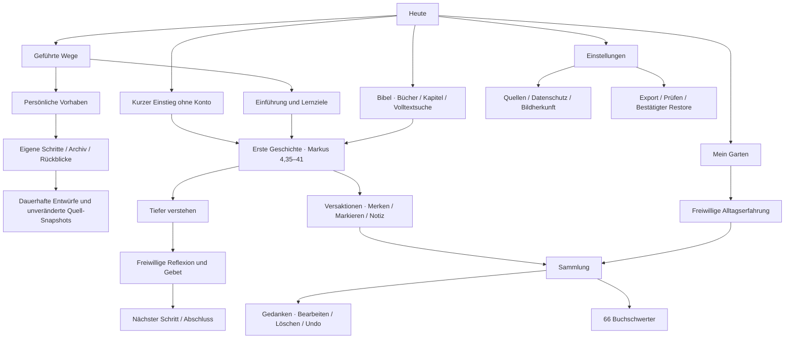

# Informationsarchitektur und Designsystem

Arbeitsmarke **OLIVA**. Eigenständiges Erscheinungsbild; Markenverfügbarkeit ist noch nicht geprüft. Keine Übernahme von FaithPath-Quellcode, Layoutdateien, Fonts oder Bildassets. Die lokal eingebundenen Open-Font-Schriften wurden neu aus ihrer Originalquelle bezogen.

## Informationsarchitektur

Fünf Primärziele: Heute, Bibel, Wege, Mein Garten, Sammlung. Auf kleinen Displays eine beschriftete untere Navigation, ab 1.000 px eine ruhige Seitenleiste. Profileinstellungen sind oben erreichbar. Reader zeigt minimale Navigation und arbeitet ohne die Hauptnavigation. Detailansichten besitzen einen eindeutigen Zurückweg. Direkte ungültige URLs führen zu einer verständlichen Fehlerseite.

## Erstkontakt in ungefähr 60 Sekunden

1. Der Hub erklärt den Nutzen und bietet eine klare Aktion: „Deine erste Geschichte“.
2. Eine kurze Einstiegsansicht beschreibt Text → Verstehen → Nachdenken und die Symbolik von Baum/Schwert in je einem kurzen Abschnitt.
3. „Geschichte lesen“ öffnet sieben echte Verse aus Markus 4. Kein Konto, kein verpflichtendes Interessenformular.
4. Bestätigung am Abschnittsende führt zurück zur Einordnung des Wegs. Freiwillige Reflexion und Gebet sind überspringbar.
5. Beim Zurückkommen helfen aktueller Weg und Weiterlesen. Der Einstieg bleibt über Einstellungen erneut zugänglich.

Das Zeit-Ziel ist eine Designannahme. Keine durchgeführte Nutzerstudie wird behauptet.

## Visuelle Sprache

Warme, zurückhaltende Editorial-Gestaltung. Naturbilder tragen Atmosphäre; die Information bleibt klar gegliedert. Große Serifentitel, gut lesbare Sans-Serif-Bedienelemente, ruhige Linien, großzügige Abstände. Kein Funktionsraster mit beliebigen Kennzahlen, keine religiöse Symbolflut. Gold markiert Entdeckung statt Belohnungswert.

Verbindliche Implementierung: `src/design-system/theme.ts`, `src/components/ui.tsx`, `global.css`. Die Komponenten `T`, `Button`, `IconButton`, `Card`, `Field`, `Tag`, `Progress` und `SectionTitle` bilden die gemeinsame Oberfläche.

| Token | Hell | Dunkel | Verwendung |
|---|---|---|---|
| Hintergrund | `#f8f7f2` | `#19251f` | Ruhiger Leseraum |
| Oberfläche | `#fffefa` | `#233128` | Karten und Eingaben |
| Weiche Fläche | `#efeee5` | `#2d3b30` | Sekundäre Hierarchie |
| Text | `#263c30` | `#f3f0e4` | Hauptinhalte |
| Sekundärtext | `#5c675b` | `#bbc3b4` | Einordnung und Hilfen |
| Primär | `#40583d` | `#c4d0a8` | Hauptaktionen |
| Gold | `#806025` | `#dfbd7c` | Akzente, Quellenlabels |
| Linie | `#dedfd4` | `#455044` | Trennung und neutrale Progress-Schiene |

Typografie: Cormorant Garamond für Titel und Bibeltext; DM Sans für Bedienung, Hilfen und Beschriftungen. Basis Körper 15/24, Sekundär 12/19, Abschnittstitel 28/33, Seitentitel 36/40, Hero bis 52/54. Reader einstellbar von 18 bis 30 plus lesespezifische Serifengröße; Zeilenhöhen 1,5 / 1,8 / 2,1. Vor einer breiten Veröffentlichung kleine Hilfslabels und vergrößerte OS-Schrift auf physischen Geräten erneut prüfen.

Abstandsskala: 4, 8, 12, 16, 20, 24, 32, 40, 48, 64. Radien: 10 / 18 / 26 / Pill. Primäre Aktionen mindestens 48 px hoch; Iconaktionen mindestens 44 × 44. Auswahl nicht ausschließlich über Farbe: Textstatus, Rahmen, Symbol bzw. `accessibilityState` ergänzen die Darstellung. Tastaturfokus im Web über sichtbare 3-px-Kontur.

## Zustände und Fehlverhalten

- Speichern wird erst nach erfolgreicher Persistenz bestätigt. Währenddessen blockiert dieselbe Mutation Doppeltippen.
- Leere Eingaben erhalten keine vorgetäuschte Erfolgsmeldung; Speichern ist deaktiviert.
- Speicherfehler und Fensterkonflikte erscheinen als Meldung; Eingaben im Editor bleiben erhalten. Beschädigte Hydrierung blockiert neue Schreibzugriffe.
- Suche zeigt hilfreiche Leerzustände und erklärt bei der historischen Lutherübersetzung mögliche ältere Wörter.
- Eine Sicherung wird zunächst geprüft und zusammengefasst. Erst eine ausdrücklich beschriftete Ersetzungsaktion stellt sie wieder her.
- Reader-Einordnung existiert nur für kuratierte Pilotabschnitte. Für andere Kapitel wird das Buchthema gezeigt und fehlende Kapitelredaktion offen benannt.

## Olivenbaum und Schwert

Sieben eigene Vektorstadien: Samen → Wurzeln → Spross → Stamm → Zweige → Blätterdach → Früchte. Stufen spiegeln unterschiedliche Lernaktionen. Früchte benötigen mindestens eine selbst festgehaltene Anwendung. Keine Stufe fällt durch Pausen zurück. Das Beibehalten einer erreichten Bildstufe nach Löschen einer Reflexion bewahrt das Bild; gelöschter persönlicher Text bleibt gelöscht.

Die Voraussetzungen stehen deterministisch in `grow()` und sind Produktlogik, keine theologische Messung. Eine Vorschau zeigt alle Stadien, trägt ein sichtbares Vorschau-Label und schreibt keinen Fortschritt. Kurzer visueller Übergang bei Stufenwechsel, OS-/App-Einstellung zur reduzierten Bewegung. Kein unendlicher Timer oder bildschirmfüllendes Belohnungsfeuerwerk.

Alle 66 Buchschwerter sind sichtbar, ohne „freigeschaltet“ werden zu müssen. Die individuelle Metadatenfamilie beschreibt Thema und Symbol. Die parametrisierte Vektorfamilie variiert Klinge, Griff, Emblem und Ornament. Die Lichtlinie folgt bestätigten **vollen Kapiteln** dieses Buchs. Ein Abschnitt im Weg bleibt davon getrennt. Das Schwert steht für Orientierung, nicht Gewalt, Status oder Überlegenheit.

## High-Fidelity-Ansichten

Die implementierten Screens sind interaktiv; Browseraufnahmen unter `docs/evidence/screens/` werden aus dem gebauten Projekt erzeugt. Die Aufnahmen sind simulierte Browser-Viewports und keine physischen iOS-/Android-Screenshots. Prüfstand und Maße stehen im Testbericht.
