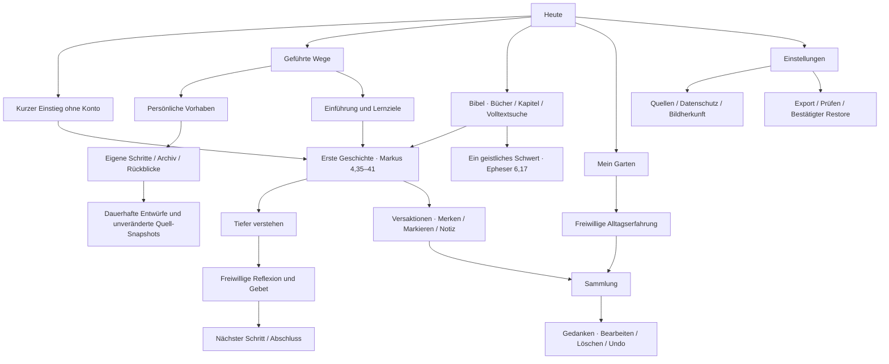

# Informationsarchitektur und Designsystem

Arbeitsmarke **OLIVA**. Eigenständiges Erscheinungsbild; Markenverfügbarkeit ist noch nicht geprüft. Eigenständige OLIVA-Oberfläche; die ausdrücklich beauftragte Übernahme von A51-Baum und Originalinhalten aus FaithPath ist mit Provenienz und Rechteausnahmen dokumentiert. Die lokal eingebundenen Open-Font-Schriften wurden neu aus ihrer Originalquelle bezogen.

## Informationsarchitektur

Fünf Primärziele: Heute, Bibel, Wege, Mein Garten, Sammlung. Auf kleinen Displays eine beschriftete untere Navigation, ab 1.000 px eine ruhige Seitenleiste. Profileinstellungen sind oben erreichbar. Reader zeigt minimale Navigation und arbeitet ohne die Hauptnavigation. Detailansichten besitzen einen eindeutigen Zurückweg. Direkte ungültige URLs führen zu einer verständlichen Fehlerseite.

## Erstkontakt in ungefähr 60 Sekunden

1. Der Hub erklärt den Nutzen und bietet eine klare Aktion: „Deine erste Geschichte“.
2. Eine kurze Einstiegsansicht beschreibt Text → Verstehen → Nachdenken und die Symbolik von Baum/Schwert in je einem kurzen Abschnitt.
3. „Geschichte lesen“ öffnet sieben echte Verse aus Markus 4. Kein Konto, kein verpflichtendes Interessenformular.
4. Bestätigung am Abschnittsende führt zurück zur Einordnung des Wegs. Freiwillige Reflexion und Gebet sind überspringbar.
5. Beim Zurückkommen helfen aktueller Weg und Weiterlesen. Der Einstieg bleibt über Einstellungen erneut zugänglich.

Das Zeit-Ziel ist eine Designannahme. Keine durchgeführte Nutzerstudie wird behauptet.

## Visuelle Sprache

Warme, zurückhaltende Editorial-Gestaltung. Naturbilder tragen Atmosphäre; die Information bleibt klar gegliedert. Große Serifentitel, gut lesbare Sans-Serif-Bedienelemente, ruhige Linien, großzügige Abstände. Kein Funktionsraster mit beliebigen Kennzahlen, keine religiöse Symbolflut. Gold markiert Entdeckung statt Belohnungswert.

Verbindliche Implementierung: `src/design-system/theme.ts`, `src/components/ui.tsx`, `global.css`. Die Komponenten `T`, `Button`, `IconButton`, `Card`, `Field`, `Tag`, `Progress` und `SectionTitle` bilden die gemeinsame Oberfläche.

| Token | Hell | Dunkel | Verwendung |
|---|---|---|---|
| Hintergrund | `#f8f7f2` | `#19251f` | Ruhiger Leseraum |
| Oberfläche | `#fffefa` | `#233128` | Karten und Eingaben |
| Weiche Fläche | `#efeee5` | `#2d3b30` | Sekundäre Hierarchie |
| Text | `#263c30` | `#f3f0e4` | Hauptinhalte |
| Sekundärtext | `#5c675b` | `#bbc3b4` | Einordnung und Hilfen |
| Primär | `#40583d` | `#c4d0a8` | Hauptaktionen |
| Gold | `#806025` | `#dfbd7c` | Akzente, Quellenlabels |
| Linie | `#dedfd4` | `#455044` | Trennung und neutrale Progress-Schiene |

Typografie: Cormorant Garamond für Titel und Bibeltext; DM Sans für Bedienung, Hilfen und Beschriftungen. Basis Körper 15/24, Sekundär 12/19, Abschnittstitel 28/33, Seitentitel 36/40, Hero bis 52/54. Reader einstellbar von 18 bis 30 plus lesespezifische Serifengröße; Zeilenhöhen 1,5 / 1,8 / 2,1. Vor einer breiten Veröffentlichung kleine Hilfslabels und vergrößerte OS-Schrift auf physischen Geräten erneut prüfen.

Abstandsskala: 4, 8, 12, 16, 20, 24, 32, 40, 48, 64. Radien: 10 / 18 / 26 / Pill. Primäre Aktionen mindestens 48 px hoch; Iconaktionen mindestens 44 × 44. Auswahl nicht ausschließlich über Farbe: Textstatus, Rahmen, Symbol bzw. `accessibilityState` ergänzen die Darstellung. Tastaturfokus im Web über sichtbare 3-px-Kontur.

## Zustände und Fehlverhalten

- Speichern wird erst nach erfolgreicher Persistenz bestätigt. Währenddessen blockiert dieselbe Mutation Doppeltippen.
- Leere Eingaben erhalten keine vorgetäuschte Erfolgsmeldung; Speichern ist deaktiviert.
- Speicherfehler und Fensterkonflikte erscheinen als Meldung; Eingaben im Editor bleiben erhalten. Beschädigte Hydrierung blockiert neue Schreibzugriffe.
- Suche zeigt hilfreiche Leerzustände und erklärt bei der historischen Lutherübersetzung mögliche ältere Wörter.
- Eine Sicherung wird zunächst geprüft und zusammengefasst. Erst eine ausdrücklich beschriftete Ersetzungsaktion stellt sie wieder her.
- Reader-Einordnung existiert nur für kuratierte Pilotabschnitte. Für andere Kapitel wird das Buchthema gezeigt und fehlende Kapitelredaktion offen benannt.

## Olivenbaum und Schwert

Sieben originale A51-Baumstadien mit gemeinsamer Stadienlogik und plattformabhängiger Web-/Native-Darstellung. Originalmaster, Windlogik, statische Fallbacks und Provenienz bleiben erhalten. Die aktuelle persönliche Darstellung und Originalhistorie sind in den aktuellen Garten-Verträgen bzw. den Liefernachweisen zu0.16/0.17 beschrieben. Der Baum ist kein Glaubensscore, verliert durch Pausen keine Blätter und misst weder Gottes Liebe noch menschlichen Wert. Vorschauen schreiben keinen persönlichen Fortschritt. Reduzierte Bewegung und Fehler-/Retryzustände bleiben erhalten.

Die frühere Sammlung von66Buchschwertern wurde auf ausdrücklichen Nutzerauftrag in0.18 entfernt. Aktuell steht genau ein statisches, vorhandenes Schwert im Bibel-Hub: friedliches Symbol für Gottes Wort zuEpheser6,17, ohne Fortschritts-/Belohnungsfunktion. Geprüfter Luther-1912-Auszug, Kontext6,10–18 und Provenienz: `docs/34-single-spirit-sword.md`. Historische Originalkunst und Rechteinformationen bleiben archiviert.

## Laufende UX-Phase vom18.11.2026

Die fünf Hauptbereiche bleiben. Der Auftrag „Weniger Oberfläche, mehr Tiefe“ verlangt klare Hauptaktionen, kürzere Wege, flexible Typografie und Datenerhalt. Aktuelles Audit und zwei Vorschläge: [Freigabevorlage](35-quiet-ux-audit.md). Die0.18-Oberfläche ist bis zur ausdrücklich geforderten Freigabe unverändert. Reviewbilder sind als nicht implementierte Studien gekennzeichnet. Große Schrift wird getrennt von reiner Dokumentbreite geprüft; CSS-Vergrößerung ersetzt keine Systemschrift-/Geräteabnahme.

## High-Fidelity-Ansichten

Die implementierten Screens sind interaktiv; Browseraufnahmen unter `docs/evidence/screens/` werden aus dem gebauten Projekt erzeugt. Die Aufnahmen sind simulierte Browser-Viewports und keine physischen iOS-/Android-Screenshots. Prüfstand und Maße stehen im Testbericht.
