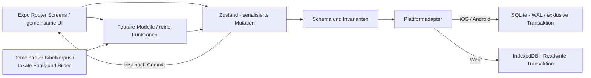

# Technische Architektur und Entscheidungen

## Ausführbarer Stand

React Native mit Expo und TypeScript, Expo Router, tokenbasierte React-Native-Styles, kleiner Zustand-Store, Zod an persistenten Daten- und Importgrenzen. Die Webausgabe stammt aus demselben Projekt und dient als lokal ausführbare, automatisiert prüfbare Vorschau. Es gibt keinen vorgetäuschten Cloud- oder KI-Dienst.

Die Paketbasis wurde aus dem am 05.11.2026 aktuellen offiziellen `expo-template-blank-typescript@58.0.32` geprüft: Expo `58.0.23`, React `19.3.0`, React Native `0.88.1`, TypeScript `6.0.3`. Native Expo-Pakete entsprechen `expo/bundledNativeModules.json`; genaue Auflösungen stehen in `package-lock.json`. Dies ist eine überprüfte Registry-/Build-Kompatibilität, keine native Gerätefreigabe. [Expo-Versionen](https://docs.expo.dev/versions/latest/), [SQLite](https://docs.expo.dev/versions/latest/sdk/sqlite/).

## Verzeichnisgrenzen

- `app/`: Routen, Bildschirmkomposition und kurzfristiger Auswahlzustand. Persönliche Texte verwenden dauerhafte Feature-Entwürfe.
- `src/features/bible`: Kanon, validierte Referenzen, Kapitel-/Abschnittsauswahl, Suchprojektion, Tagesvers.
- `src/features/paths`: eigene Lerninhalte und Quellenbezüge.
- `src/features/garden`: Bedeutungen der sieben Bildstufen.
- `src/state/model.ts`: persistentes Schema, Fortschrittsinvarianten, Baumprojektion, Backupprüfung.
- `src/state/store.ts`: Mutationssperre, Kopie validieren, persistieren, erst dann veröffentlichen.
- `src/services/storage.{ts,web.ts}`: SQLite bzw. IndexedDB, Revisionen und Plattformexport.
- `src/components`, `src/design-system`: gemeinsam verwendete Darstellung ohne Speicherautorität.
- `src/data`: deterministisch importierter Originaltext und Buchmetadaten.
- `scripts`: reproduzierbarer Import, Expo-CLI, Vorschau und Offline-Paket.
- `tests`: Fach-/Persistenztests und tatsächliche Browserabläufe.
- `database/migrations`: optionale Cloud-Grundlage; nicht automatisch angewendet.

## ADR-001 · Native Basis, Web als Prüffläche

Die bevorzugte native Basis wird verwendet. Eine reine Website wäre kein Ersatz für die gewünschte iOS-/Android-Architektur. Ein gemeinsamer Webexport ermöglicht hier Browser- und Offline-Tests. Native Bundles lassen sich ohne Store-Schlüssel erzeugen; ein fertiges signiertes IPA/APK benötigt die jeweilige Toolchain und Kontokonfiguration.

## ADR-002 · Lokaler Kern vor Serverzustand

Der aktuelle Kern hat keinen Remote-State. Deshalb kein TanStack Query und kein Supabase-SDK als leere Abhängigkeit. Beide werden erst mit einer realen Synchronisationsschicht eingeführt. NativeWind ist nicht erforderlich: zentralisierte Tokens und gemeinsame native Komponenten erfüllen die Styling-Anforderung bei weniger Build-Abhängigkeiten.

## ADR-003 · Bibeltexte als versioniertes Offline-Bundle

Der vollständige Luther-1912-Korpus wird beim Build mitgeliefert. Für den initialen, unveränderlichen Korpus ist das einfacher als 31.102 erste Laufzeit-Inserts. SQLite speichert auf nativen Plattformen persönliche Daten. Eine spätere Mehrübersetzungsbibliothek erhält ein separates, versioniertes SQLite-Inhaltsrepository mit Download-Manifest und Integritätsprüfung. **SQLite-Inhaltsdownloads sind noch nicht implementiert.**

Die Webversion verwendet IndexedDB statt `expo-sqlite`-WASM: Letzteres erfordert besondere WASM-/SharedArrayBuffer-/Cross-Origin-Header. Das vermeidet eine Hostingvoraussetzung für die Vorschau. Der Fachvertrag ist derselbe. [Expo-Dokumentation](https://docs.expo.dev/versions/latest/sdk/sqlite/).

## ADR-004 · Keine stillen Datenverluste

Eine lokale Revision wird in einer Datenbanktransaktion mit dem gespeicherten Wert verglichen. Ein zweites Fenster darf einen veralteten Stand nicht überschreiben. Der Store publiziert erst nach erfolgreichem Commit. Ein globaler Mutationslock verhindert Doppeltippen; er ist klein und enthält keine UI-Navigation. Nach einer fehlerhaften Hydrierung blockieren neue Schreibvorgänge. Es gibt keine automatische Rücksetzung auf leere Daten.

Die aufeinander aufbauenden SQLite-Schemata bis Version 3 sind in `src/services/local-migrations.ts` definiert. Ein neueres `PRAGMA user_version` wird abgelehnt statt zurückgestuft. Neue Migrationen müssen transaktional sein und einen realen Upgrade-/Abbruchtest erhalten. Web-Schema 1 verwendet den Object Store `state`: `main`, Archiv-Blobs und Rückkehrsicherung werden dort gemeinsam transaktional verwaltet.

Das JSON-Nutzdatenmodell ist für einen kleinen persönlichen Bestand geeignet und Zod-validiert. Für große Archive und inkrementellen Sync wird es in einzelne Entitätstabellen zerlegt. Kein pauschaler Skalierungsanspruch für den lokalen Snapshot-Ansatz.

## ADR-005 · Cloud-Sync bleibt ausdrücklich optional

Die Migrationen definieren Auth-gebundene Daten, Kanonreferenzen, Owner-RLS und Notizrevisionen als Vorbereitung. Es wurde keine Supabase-Instanz angelegt oder verbunden. Live-Auth, Berechtigungen und RLS wurden daher nicht als bestanden ausgegeben.

Vorgesehener Sync-Vertrag: lokale Outbox pro Entität mit stabiler ID, Basisrevision und Tombstone; Kapitelbestätigungen als Mengenunion; Notizkonflikte als zwei erhaltene Textversionen mit Nutzerauswahl; keine Last-write-wins-Regel für persönliche Worte. Vor Auth-Abmeldung oder Kontowechsel müssen lokaler Gastbestand und Kontobestand getrennt bleiben. Gast → Konto erfordert eine Vorschau und ausdrückliche Zustimmung. Serverseitige Service-Role-Schlüssel gehören ausschließlich auf den Server.

Abnahme: Nutzer A kann Daten von B weder lesen noch schreiben; unauthentifizierte Anfragen erhalten keine persönlichen Daten; Tokenablauf löscht keine lokalen Texte; zwei Offline-Geräte konvergieren ohne Verlust; Kontolöschung entfernt abhängige Serverdaten. Diese Szenarien sind noch offen.

## ADR-006 · KI nur mit Quellenvertrag

Eine spätere serverseitige Funktion erhält eine begrenzte Frage und validierte Referenz-IDs, lädt den erlaubten Text selbst und ruft einen konfigurierten Provider mit serverseitigem Schlüssel auf. Antwortschema: `explanation`, `citations[{book,chapter,from,to}]`, `traditions[]`, `uncertainty`, `kind:'ai-explanation'`. Direkte Zitate werden aus dem lokalen kanonischen Text gerendert, nicht aus frei generierten Modellzeichenfolgen.

Jede Referenz muss existieren. Unbelegte Antworten bzw. fehlende Quellen führen zu einer transparenten Unsicherheitsantwort. Kein Sprechen im Namen Gottes, keine diagnostischen Aussagen über den Glauben der Person, keine Lebensentscheidungen als göttliche Anweisung. Rate-Limit, Auth-/Gast-Quota, Zeitlimit, maximale Antwortlänge, Providerfehlerzustand und Löschregeln sind Teil des Betriebs. Keine Notizen automatisch mitsenden. Opt-in und vollständige Abschaltung sind Voraussetzung. **Dieser Dienst ist nicht implementiert.**

## Sicherheit und Datenschutz

RN-Textausgabe statt HTML-Injektion; keine Interpretation persönlicher Texte als Markup. Ab 0.3: OLIVA-Backup und schreibbarer Gesamtbestand maximal 64 MiB, FaithPath-V5-Quelle maximal 10 MiB UTF-8, begrenzte JSON-Tiefe/Knoten und strikte Schema-/Referenzprüfung. Keine Ersetzung oder Übernahme vor expliziter UI-Aktion. Keine Secrets im Quellcode oder im öffentlichen Bundle. Keine Analyse- oder Werbe-SDKs. Native Datenbank und Webbestand sind nicht zusätzlich verschlüsselt; OS-/Browser-/Export-Sicherheit bleibt relevant. Cloud-Sync, Telemetrie, Push und Audio sind nicht versteckt aktiviert.

Logging in Tests und Build enthält ausschließlich technische Ergebnisse. Für Produktion ist optionales Fehler-Monitoring mit Datenminimierung vorzusehen: keine Notizen, Gebete, Fragen oder Exportinhalte in Logs; pseudonyme Ereignisse nur mit passender Rechtsgrundlage. Ein Datenschutztext für einen konkret betriebenen öffentlichen Dienst ist noch nicht rechtlich freigegeben.

## Offline und Performance

Native Bibel, Schriften und Bilder werden mitgeliefert. Der Web-Build erzeugt ein vollständiges Cache-Manifest; Installation gelingt nur, wenn alle Pflichtdateien geladen sind. Fremde Caches werden nicht gelöscht. Navigation nutzt bei Netzfehlern die gespeicherte App-Shell; dynamische Routenchunks werden ebenfalls vorgehalten, damit auch bislang unbesuchte Kapitel offline aufgehen.

Der vollständige Bibelkorpus erhöht die Erstgröße des JavaScript-Bundles. Der lokale Vorschauserver komprimiert Textdateien per gzip. Der Produktionshost muss Brotli/gzip anbieten. Bildkarten verwenden 640er WebP-Varianten, Heroansichten 1280er; Original-PNGs sind keine Laufzeitassets. Speicher-/Startmessungen auf schwächeren echten Android-Geräten bleiben offen. Vor mehreren Übersetzungen sind partitionierte Inhalte und ein SQLite-Volltextindex sinnvoll.

## ADR-007 · Dauerhafte Entwürfe und Payload-Version 2

Version 0.2 ergänzt persönliche Vorhaben und Entwürfe. `src/features/personal/` enthält getrennte Schemas, reine Übergangsfunktionen, einen gemeinsamen Draft-Hook und UI-Editoren. Die bestehende SQLite-/IndexedDB-Struktur bleibt bestehen; `decodeData()` migriert validierte V1-Payloads ohne Veränderung der bisherigen Inhalte. Hintergrundsicherungen und explizite Aktionen teilen eine Commit-Warteschlange; stabile Entwurfs-ID und Revision schützen zusätzlich gegen veraltete Editorstände. Details und bekannte Grenzen stehen in [Iteration 0.2](06-personal-and-drafts.md).

## ADR-008 · Additiver V5-Import und unverändertes Originalarchiv

Version 0.3 hebt das Nutzdatenformat auf 3 und die native SQLite-Struktur auf 2; IndexedDB bleibt physisch Version 1. `src/features/imports/` trennt Quellvertrag, reine Vorschau/Zuordnung, Herkunft und historische Anzeige. Quell-IDs und belegte Spiegelaliase bleiben stabil. Hash-Indizes und Verknüpfungsindizes vermeiden paarweise Suchen durch alle Gedanken. Lokale Bearbeitungen werden nicht durch spätere Exporte ersetzt. Die Originaldatei bleibt unverändert als Teil des eigenen Backups erhalten. Import und Rückkehrsicherung teilen eine Transaktion; beim Rollback werden Token, Revision und Verbrauch ebenfalls gemeinsam geprüft. Beide Plattformadapter sind gegen tatsächliche Transaktionsspeicher geprüft (Web-IndexedDB bzw. Node-SQLite mit nativer Adapterlogik); die Expo-Gerätelaufzeit bleibt offen. Ausführliches Mapping und Kompromisse: [Iteration 0.3](07-faithpath-import.md).

Die in 0.3 zunächst gewählte Inline-Archivierung erhöhte Kopier-/Serialisierungskosten kleiner Commits. Seit 0.4 liegen unveränderliche Quellen in separaten lokalen Blobs; der öffentliche Backupvertrag enthält sie weiterhin vollständig. Es gibt bislang keine Laufzeitmessung auf schwachen nativen Geräten.

## ADR-009 · Quellbezogene Entwürfe, private Archiv-Blobs und sichere Updates

Version 0.4 verwendet AppData/Backup V4, privates Speicherdokument V1, SQLite physisch V3 und IndexedDB physisch V1. Capture-Entwürfe bewahren Originalfrage und Quellen-Snapshot; Abschluss und Entfernung erfolgen atomar. Noch ungesicherte Worte bleiben mit Besitzer-/Abschlusskennung in der Sitzung und werden nie als dauerhaft gespeichert ausgegeben. Beschädigte Daten führen zu einem gesperrten Reparaturbildschirm mit Rohdatenexport.

Inhaltsadressierte Archiv-Blobs entlasten kleine Commits. Hauptstand, Rückkehrsicherung, Revisionsvergleich und Blob-Bereinigung teilen eine Transaktion; die Sicherung hält ihre Quellbezüge bis zum Verbrauch. Der Webworker prüft exakte Build-Identität, hält einen Vorgänger-Cache für alte Clients und erzwingt keinen Reload. Der echte 0.3→0.4-Offlinewechsel wird mit einem getrennten Kontrollbuild geprüft. Verträge, Migrationen und Grenzen: [Iteration 0.4](08-continuity-and-offline.md).
