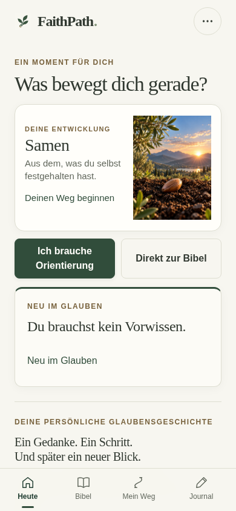
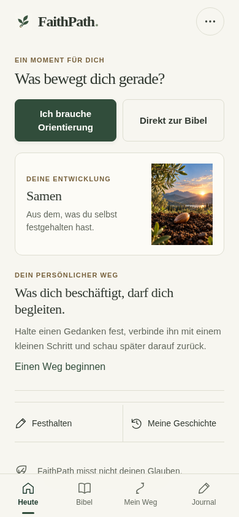
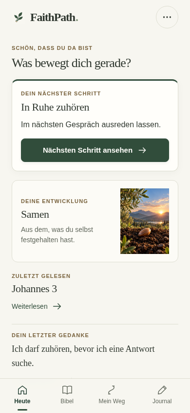
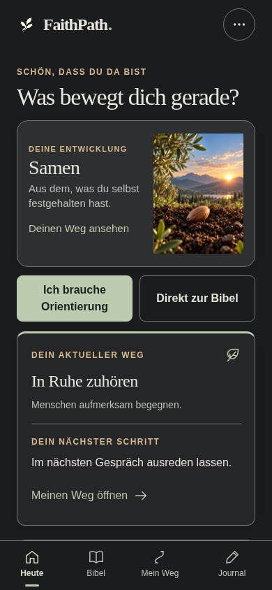
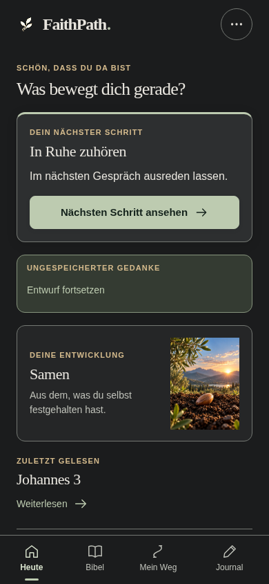
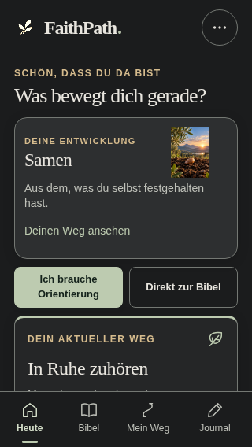
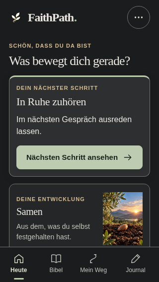

# FaithPath — UI/UX Phase 1: Heute und Einstieg

Stand: 16.10.2026. **GO für isolierte Preview- und Geräteabnahme. Keine Produktionsfreigabe.** Implementiert und im echten Chromium geprüft; kein Mockup und kein ausschließliches Konzept. Keine Netlify-Veröffentlichung und keine Änderung an main.

## Geprüfter Stand

- Repository: `akwasiacheampongma-code/Faithpath-`.
- Arbeitsbranch: `feature/uiux-phase1-today-20261016`.
- Ausgangscommit: `00387e1a4d87227b76adc4cf9bf8c7efd5ea6be1`, mit der vollständig gelesenen Spezifikation `docs/UIUX_PHASE1_TODAY_2026-10-16.md`.
- Enthaltene stabile Inhaltsbasis: `c2aaa481fe11874c2fff649311e4970c380ab092` (NMC2, 2.314 Nachlese-MC-Fragen, finaler NT-Bestand und STABLE1).
- Implementierungscommit: `92b296eb51bdd7454b18b2962790ca0d8bb684e1`. Der abschließende Dokumentations-HEAD steht im Lieferbeleg; danach wurden ausschließlich Nachweise und Dokumentation ergänzt.
- Preview-Build: **`FP4-20261016-G-STABLE1-UIUX1`**.

## Tatsächlich umgesetzte Verbesserungen

1. **Erstbesuch — klarer Einstieg.** „Ich brauche Orientierung“ und „Direkt zur Bibel“ stehen vor der Baumkarte und sind auf 390 × 844 ohne Scrollen erreichbar. Neue App-Nutzer werden auf Heute nicht mehr als „Neu im Glauben“ bezeichnet. Der bestehende Anfängerleitfaden bleibt über Orientierung erreichbar und wurde im Browser bis zum tatsächlichen Ziel geöffnet. Eine kurze Erklärung des persönlichen Weges ersetzt wiederholte Einführungstexte.
2. **Rückkehr — konkreter Schritt zuerst.** Der bestehende aktive Weg mit offenem Schritt wird wie bisher ausgewählt, aber direkt oben gezeigt. Titel und Schritt bleiben vollständig lesbar. Es gibt genau eine klare Aktion zum richtigen Weg. Doppelte aktuelle Wege-Links in Baum, Kartentitel und Begleiterliste entfallen; andere Wege bleiben über höchstens zwei Vorschauen und die vorhandene Gesamtübersicht erreichbar.
3. **Entwurf — sichtbar und geschützt.** Der Hinweis auf ungespeicherte Worte steht vor der Baumkarte. „Entwurf fortsetzen“ verwendet weiterhin exakt die vorhandene Entwurfsaktion. Es wird nichts beim bloßen Anzeigen gelöscht, überschrieben oder als gespeichert ausgegeben. Auch ein erster ungespeicherter Gedanke verdrängt nicht die beiden neutralen Einstiege.
4. **Kontinuität — persönliche Fortsetzungen zusammenführen.** Zuletzt gelesene Bibelstelle und letzter tatsächlicher Gedanke folgen auf Baum und priorisierte Aktion. Der Rückblick erscheint nur bei einem wirklich fälligen Eintrag aus der unveränderten Domainlogik. Bei mehreren Rückblicken wird eine Einladung angezeigt, ergänzt um den vorhandenen Rückblicke-Bereich; kein neues Aufgaben-Dashboard.
5. **Sonderfälle — keine falschen Versprechen.** Archivierte Wege werden nicht als aktueller Weg ausgewählt. Ein aktiver Weg ohne offenen Schritt bekommt keine erfundene Aufgabe. Leseverlauf, Journal und geführter Verlauf werden als vorhandene Nutzung erkannt. Der Link „Wege und Archiv öffnen“ benennt sein tatsächliches Ziel korrekt; der bestehende Archivfilter wurde bis zum echten archivierten Eintrag getestet.
6. **Gestaltung — fokussierte Hierarchie.** Serifenüberschrift und vorhandene warme Farben bleiben. Eine klare Handlungskarte, kompakte vollständige Baumkarte, ruhige Fortsetzungsbereiche, konsistente Abstände und Touchflächen reduzieren die visuelle Konkurrenz. Hell, Atmosphärisch, Papier und Nacht bleiben erhalten. Es gibt keine neue Animation, Navigationsebene, Spielmechanik oder spirituelle Bewertung.

## Vorher / Nachher: echte Messungen und Bilder

Gleiche synthetische Daten, gleiche Viewports, gleiche Schriftgröße, dieselben sieben Baumgrafiken. Die y-Werte beziehen sich auf den oberen Dokumentanfang; die feste untere Navigation beginnt bei 390 × 844 bei y=773 und bei 320 × 568 bei y=497. Gerundete Messwerte aus Hell:

| Zustand | Breite | Vorher | Nachher |
|---|---:|---:|---:|
| Rückkehrer: Ende der Schritt-Aktion | 390 | y=731 | **y=331** |
| Rückkehrer: Ende der Schritt-Aktion | 320 | y=679, unter der Navigation | **y=341, direkt erreichbar** |
| Offener Entwurf: Beginn des Hinweises | 390 | y=1116 | **y=368** |
| Offener Entwurf: Beginn des Hinweises | 320 | y=1044 | **y=370** |
| Rückkehrer: vollständiges Bild des Baums, Unterkante | 390 | y=363, vor dem Schritt | **y=519, nach dem Schritt, vollständig sichtbar** |
| Rückkehrer mit Entwurf: Baum-Unterkante | 390 | y=363, Entwurf weit unterhalb | **y=621, Schritt und Entwurf davor erreichbar** |
| Neuer Nutzer: Baum-Unterkante | 390 | y=363, Einstiege danach | **y=400, beide Einstiege davor** |

Der Baum wurde nicht entfernt oder abgeschnitten. Bei 320 Pixeln ist er im neuen Standardfall größer dargestellt als zuvor; bei Entwurf, sehr langen Texten und Textzoom darf die Seite natürlich länger werden. Es wird kein universelles „alles ohne Scrollen“ für unbegrenzt lange Nutzereingaben behauptet. Die erste primäre Aktion bleibt erreichbar; sichtbare Reihenfolge, DOM-Reihenfolge und Tastaturreihenfolge stimmen überein.

**120 neue Rohaufnahmen** dokumentieren die fünf geforderten Zustände × drei Viewports × zwei Themes × Vorher/Nachher × Viewport/Vollseite. Dazu kommen Screenshots der weiteren Themes, sieben Baumstufen, Zoom- und Stressfälle. `VERGLEICH.html` im Prüf-ZIP zeigt sechs ausgewählte Paarvergleiche offline ohne externe Ressourcen. `comparison.json` enthält alle 30 passenden Messpaare; die Originalbilder sind unverändert enthalten.

### 1. Erstbesuch, Hell, 390 × 844 — verbessert

### 2. Rückkehrer, Hell, 390 × 844 — verbessert

### 3. Entwurf, Nacht, 390 × 844 — verbessert

### 4. Rückkehrer, Nacht, 320 × 568 — verbessert, natürlicher Scrollweg zulässig

Offener Rückblick und ausschließlich archivierter Weg sind zusätzlich mit Vorher-/Nachher-Bildern und tatsächlichen Navigationsflüssen im Prüf-ZIP belegt. Die Screenshots zeigen vorhandene Daten und tatsächliche Bedienung, keine erfundenen Erinnerungen.

## Architektur und Bestandsschutz

Die Änderung betrifft nur Heute und das Laden seines neuen Stylesheets:

- `src/today-model.js`: reine, deterministisch testbare Auswahl. Nutzt die unveränderten Funktionen `gaps()` und `treeLevel()`, liest keine Browserdaten selbst und schreibt nichts.
- `src/today-view.js`: eigenständige Darstellung mit dokumentiertem Adapter zu vorhandenen UI-Helfern, Aktionen und Routen. Persönliche Texte werden weiterhin escaped. Keine eigenen Speicher- oder Eventsysteme.
- `src/today.css`: ausschließlich auf `.today-phase1` begrenzte Regeln mit bestehenden Theme-Tokens, natürlicher Höhe, vollständigen Bildern und 44-Pixel-Touchzielen.
- `src/app.js`: die bisherige Heute-Funktion wurde auf einen kleinen Adapter reduziert. Die übrigen Ansichten und Aktionen bleiben unverändert.
- `index.html` / `scripts/build.mjs`: Stylesheet in Entwicklung und versioniertem Release verlinken. Die bestehende Build-/Worker-Assetliste nimmt die neuen Dateien automatisch auf. Keine Änderung am Worker-Template oder Updateprotokoll.

**194 vorhandene Dateien sind bytegleich** mit dem Ausgangscommit: sämtliche Inhaltsdateien, Bibeltexte, N-/FP-IDs, Verknüpfungen, Indexdateien, Baumgrafiken, Theme-Definitionen, globale Styles sowie bestehende Domain-, Speicher-, Import-, Entwurfs- und sonstige Quellmodule außer dem abgegrenzten Heute-Adapter und der Build-ID. Keine neue Abhängigkeit, Datenmigration, Fortschrittslogik, Speicherkennung oder Themedefinition. Der Content-Hash ist exakt derselbe wie bei NMC2.

Die Erhaltung persönlicher Daten wurde außerdem mit synthetischen Nutzerdaten im Browser geprüft; der Dateivergleich allein wäre dafür kein Beweis. Die 2.314 Nachlese-Fragen, 1.300 NT-Kapitelfragen, Story-Verknüpfungen, Reflexionsfragen und historische Inhaltsprüfungen bestehen weiterhin. Es fand keine erneute redaktionelle Bearbeitung statt.

`ENTSCHEIDUNGEN.md` erklärt die kleinen Modulgrenzen, Gründe, Risiken und den empfohlenen Änderungs-/Testablauf für menschliche Entwickler. Die ursprüngliche Gesamtsanierung, Reader-Polish, Journal-Filter und neue Funktionen bleiben außerhalb dieser Phase.

## Ausgeführte Tests

| Suite / Nachweis | Ergebnis |
|---|---:|
| Vorhandene Node-Tests plus dreizehn neue Heute-Regressionsfälle | **139 PASS, 0 FAIL, 0 übersprungen** |
| Heute: 13 Zustände × zwei kleine Größen × vier Themes | 104 PASS |
| Heute: axe und tatsächliche Tastatur-Navigation, je Theme/Größe | 8 PASS |
| Heute: Orientierung, vorhandener Leitfaden, Bibel und abgebrochene Weganlage | 8 PASS |
| Heute: sieben Baumstufen, lange Inhalte, 200 % Text, simulierte Safe Areas | 10 PASS |
| Chromium-Seitenskalierung 200 %, tatsächliche Visual-Viewport-Messung und Tastaturaktion | 2 PASS |
| Vorhandene Kernabläufe im Browser | 12 PASS |
| Import-/Entwurfs-/Weg-Stabilisierung | 12 PASS |
| Reader-/Kapitelquiz-Integration | 17 PASS |
| NT-Finalbestand: 90 tatsächlich beantwortete Fragen | 24 PASS |
| Echter Nachlese-Bestand auf kleinen Bildschirmen | 36 PASS |
| Synthetische Nachlese-Auswahl-/Fehler-/Fallback-Fixtures | 6 PASS |
| Bestehende Service-Worker-Regression | 3 PASS |
| Echter NMC2→UIUX1-Wechsel auf derselben lokalen Origin | 7 PASS |
| **Browser-/Worker-Prüfpunkte insgesamt** | **249 PASS** |

Die dreizehn neuen Node-Fälle wurden vor der jeweiligen Implementierung als fehlschlagend nachgewiesen. Sie prüfen Auswahl aktiver/archivierter Wege, tatsächlich offene Schritte, vorhandenen Verlauf, genaue Gedanken-IDs und Ziele, die bestehende Fokusübergabe zur Heute-Überschrift, echte Fälligkeit, Entwürfe, alle Baumstufen, Datenunveränderlichkeit, redundante Links und HTML-Escaping. Dreizehn Node-Tests und 249 Browserprüfpunkte werden nicht mit Bildschirmaufnahmen oder sämtlichen Inhaltsdatensätzen zu einer künstlichen Testzahl addiert.

Weitere bestandene Validatoren: finaler NT-Excelmaster, vollständiger Nachlese-Nachweis und historische Materialisierung. Der Browser vergleicht die tatsächlich geladenen Nachlese-Dateien vollständig mit dem Quellbestand; es wird keine erneute Einzelinteraktion mit allen 2.314 Fragen behauptet. Der Content-Hash und der Dateivergleich sichern die gesamte unveränderte Datenbasis.

Die Sonderzustände enthalten Erstbesuch, aktiven Weg, Entwurf, ausschließlich ersten Entwurf, fälligen Rückblick, viele Rückblicke, ausschließlich archivierten Weg, Weg ohne offenen Schritt, nur Bibelverlauf, nur Journal, nur geführten Verlauf, viele Wege und lange persönliche Inhalte. Der Archivfall wurde bis zum tatsächlichen ruhenden Weg geöffnet. Bei Normalansicht wurden Touchgrößen, vollständige Bilddarstellung, horizontaler Overflow und Überdeckungen jeder Heute-Aktion geprüft; nicht nur CSS-Regeln gelesen.

Historische Variant-B-Skripte enthalten Erwartungen an die nun ausdrücklich entfernten doppelten Baum-Aktionen. Diese Designannahmen wurden durch die neuen Heute-Akzeptanztests ersetzt; die alten Berichte wurden nicht umgeschrieben. Alle oben aufgeführten fachlichen Regressionen wurden auf dem finalen Kandidaten erneut ausgeführt.

## Barrierefreiheit und Grenzen

Acht axe-Prüfungen der Heute-Seite über alle vier Themes und beide kleinen Größen ergeben keine Verletzungen des geprüften Regelsets (WCAG 2 A/AA und 2.1 AA). Zusätzlich wurden 44-Pixel-Touchflächen, tatsächliche Erreichbarkeit ohne Überdeckung, Tastaturaktivierung mit sichtbarem Fokus, eine Hauptüberschrift, benannte Einstiegs-/Fortsetzungsbereiche, reduzierte Bewegung und natürliche Scrollwege geprüft. 200 % Textgröße und Safe-Area-Werte wurden gezielt simuliert. Die zusätzliche Chromium-Seitenskalierung setzt den tatsächlichen Visual Viewport auf 160 bzw. 195 CSS-Pixel bei Faktor 2; sie ist kein Test einer physischen Pinch-Geste.

Diese Ergebnisse sind **keine vollständige WCAG-Zertifizierung** und kein Nachweis für Safari oder VoiceOver. Echte iPhone-Safe-Areas, Bildschirmtastatur, Home-Screen-PWA, VoiceOver, Betriebssystem-Speicherdruck und lange Wiederaufnahme bleiben **OFFEN**. Die genaue manuelle Anleitung steht in `REPRODUZIEREN.md`.

## Offline und Update

Der reale NMC2-Vorgänger wurde mit seinem unveränderten Hash geprüft und zuerst auf Port 4362 vollständig installiert. Danach wurde ausschließlich diese lokale Origin auf UIUX1 umgestellt. Ein echter Dokument-Reload entdeckt den neuen Worker; Aktivierung erfolgt erst über „Jetzt aktualisieren“.

Vorhanden waren 260 Kapitel-Fortschrittsschlüssel, Storyfortschritt, V3→V5-Migrationsnachweis, Journal/Weg-Verbindung, Bibelmarkierung inklusive Luther Johannes 10,11 und offener Entwurf. Bei Worker-Aktivierung und Offline-Reload bleiben die persönlichen Speicherbytes identisch. Das neue Heute-Modul und sein versioniertes CSS laden vollständig offline; der richtige Weg und der gleiche Entwurf sind erreichbar. Beide Bibeln, Nachlese-MC und Kapitelquiz bis Offenbarung funktionieren offline. Absichtliche Reader-Aktionen dürfen nur Leseposition/Ereignisse ergänzen; die übrigen Daten und alten Ereignisse bleiben erhalten. Der Entwurf lässt sich anschließend offline fortsetzen und speichern.

## Reproduzierbarer Preview-Build

Zwei Ausgabeordner, **324 bytegleiche Dateien**; jede veröffentlichte Datei zusätzlich gegen `release-integrity.json` geprüft. Drei neue Dateien gegenüber NMC2 sind Heute-Modell, Heute-View und Stylesheet. Der Build enthält die komplette App, nicht nur die Heute-Seite.

- Build-ID: `FP4-20261016-G-STABLE1-UIUX1`
- Build-Hash: `7f7ec73b955f7a8ca603ec78937a898633784d9cd229b9192ea4845bd88d3b0b`
- Content-Hash, identisch zu NMC2: `8630cf25034cbd8ee28060b2318addc25d26611317439d08ac2fa5cae938e309`

Commit, Build-Hash und Content-Hash sind verschiedene Nachweise. Das Build-ZIP hat die App-Dateien direkt in seiner Wurzel, einschließlich `index.html`, `BUILD.txt`, Worker und beiden Integritätsdateien. Das Prüf-ZIP enthält Bericht, Vorher-/Nachher-Aufnahmen, Vergleichsansicht, Messwerte und Rohprotokolle; dadurch muss zum Lesen des Berichts kein großes Doppel-Build-Archiv geladen werden. SHA-256-Dateien und Lieferbeleg stehen neben den ZIPs. Die genaue Reproduktion ist dokumentiert.

## Freigabeempfehlung

**GO für isolierte Preview- und Geräteabnahme dieses Kandidaten.** Die dokumentierten Phase-1-Kriterien sind in den tatsächlich verfügbaren Browserumgebungen erfüllt; in den ausgeführten Prüfungen bleiben keine reproduzierbaren technischen Blocker offen. Die sichtbare Verbesserung wird durch echte Bilder, konkrete Messungen und ausgeführte Nutzungsflüsse belegt.

**NO-GO für Produktion bis zum erfolgreichen Geräte-Gate.** Es wurde kein Netlify-Deploy ausgeführt, keine öffentliche Preview erzeugt und main nicht verändert. Deshalb wird kein Preview-Link behauptet. Der vollständige Preview-Build ist zur gesonderten isolierten Bereitstellung lieferbar. Keine Ausweitung auf weitere Produktbereiche, bevor dieser Heute-Stand visuell und auf echten Geräten abgenommen ist.
