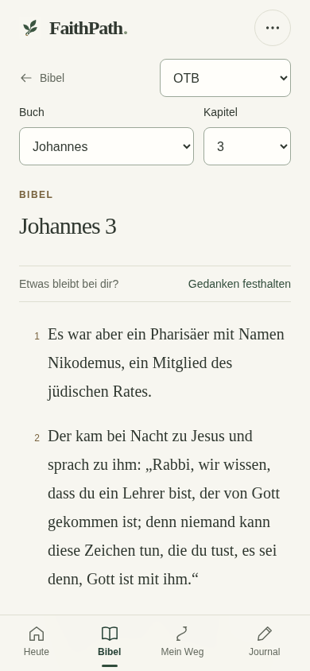
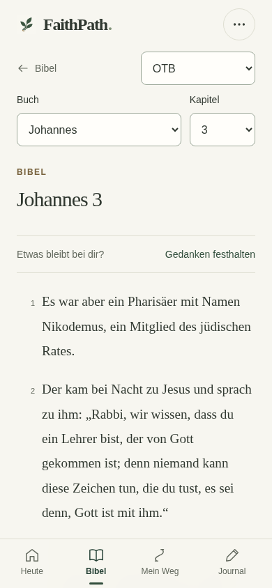
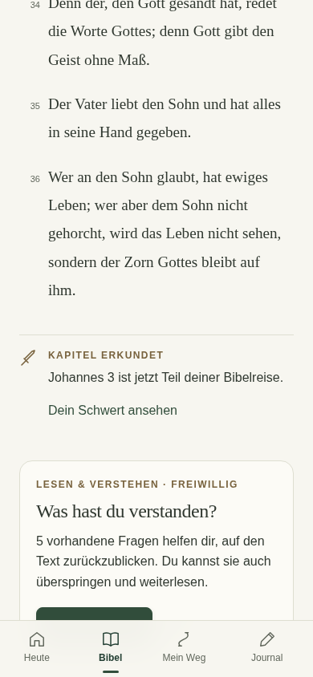
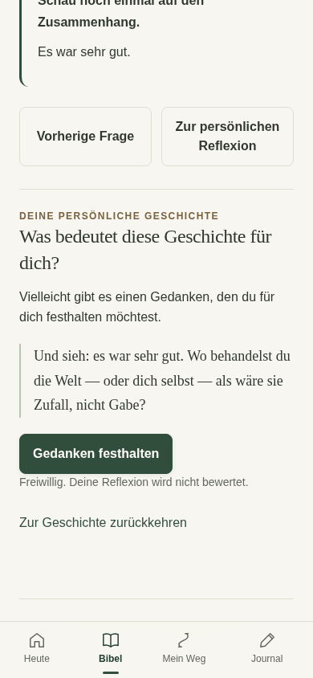
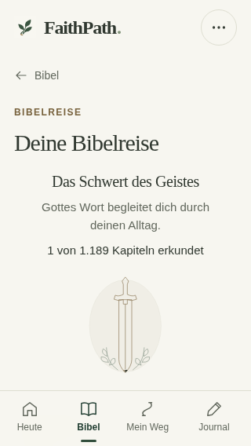
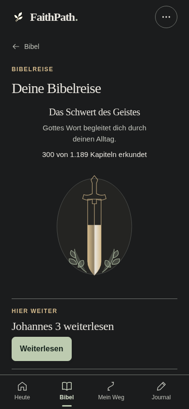

# FaithPath UI/UX Phase 2 – Implementierungs- und QA-Bericht

Stand: 16.10.2026. Repository: `akwasiacheampongma-code/Faithpath-`.

## Ergebnis und Freigabeempfehlung

Reader, Geschichten/Reflexion und die zentrale Bibelreise mit dem Schwert des Geistes sind im vorhandenen Stack implementiert. Hinzu kommt die nachgewiesene Korrektur eines bisherigen Kurzkapitel-Fehlers: Ein beim Öffnen bereits sichtbares Kapitelende zählt nicht mehr automatisch als Erkundung. Keine Inhalte neu importiert, zusammengeführt oder umformuliert. Kein Frameworkwechsel, keine neue Abhängigkeit, keine Migration.

**GO für isolierte Bereitstellung und echte Geräteabnahme. NO-GO für Produktionsfreigabe, bis iPhone Safari, installierte iPhone-PWA und VoiceOver bestanden sind. Die noch offene Geräteabnahme von UIUX1 bleibt ausdrücklich offen.** Es wurde nichts auf Netlify veröffentlicht und main nicht bearbeitet.

## Geprüfter Stand

- Arbeitsbranch: `feature/uiux-phase2-reader-stories-20261016`.
- Ausgangs-HEAD mit vollständig gelesener Spezifikation: `3afa15ffc13a9a106e2449c3b6fe616eebf8f069`.
- Darunterliegende UIUX1-Grundlage: `bdc9dc53cc5e379b8a07845683654bab14e91ab7`.
- A Reader: `669b65f` – nach 141 Unit-Tests, 17 vorhandenen Kapitel-Browserprüfungen und acht neuen Reader-Prüfungen.
- B Geschichten/Reflexion: `5a7ba1c` – nach 143 Unit-Tests, 16 Reader-/Geschichtenprüfungen und 36 vorhandenen Nachlese-Browserprüfungen.
- C Schwert/Bibelreise: `a8d0b73` – nach 146 Unit-Tests und den zugehörigen Browser-/Offline-Prüfungen.
- Zusätzliche belegte Kurzkapitel-Korrektur: `0eb06e91cf6b0f153061de265997771a96e2c646`. Dieser Commit enthält den finalen Anwendungscode. Der spätere QA-/Dokumentationscommit wird im separaten Lieferbeleg ausgewiesen.

Produktionsquellstand und Live-Seite waren kein Veröffentlichungsziel dieser Phase. Geprüft wurde der benannte Entwicklungsstand und sein lokaler statischer Preview-Build; es gibt keinen neu veröffentlichten Preview-Link.

## A – Reader

Der Bibeltext bleibt im Mittelpunkt: ruhige Serifen-Typografie, gleichmäßiger Zeilenabstand, dezente Versnummern, kompaktere Buch-/Kapitelwahl und klar abgegrenzte Versaktionen. Bestehende Übersetzungen, Auswählen, farbige Markierungen, Kopieren, Notizen, Journal- und Wegverbindungen bleiben erhalten. Die neuen Regeln gelten nur auf den betroffenen Seiten; globale Styles und Heute sind unverändert.

Am NT-Kapitelende steht „Was hast du verstanden?“ mit den fünf vorhandenen Fragen, freiwilligem Start und „Später“. Weiterlesen und Gedanken festhalten bleiben unabhängig davon erreichbar. AT-Kapitel ohne freigegebene Einheit bekommen kein erfundenes Quiz. Beim Wechsel zum nächsten/vorherigen Kapitel bleiben Übersetzung und ursprünglicher Geschichten-/Wegkontext erhalten.

Die Darstellung von Angebot und Kapitelnavigation ist in `src/reader-view.js` ausgegliedert. Katalog und Speicherzustand bleiben im vorhandenen Adapter. Keine neue Fortschritts-ID.

## B – Geschichten und persönliche Reflexion

Der vorhandene aktive Geschichtenablauf bleibt maßgeblich: 436 Geschichten, 2.479 primäre Fragenpositionen, 2.574 erreichbare Quell-IDs einschließlich 95 bestehender Alias-Zuordnungen. Die 2.314 Nachlese-MC-Fragen und 260 ursprünglichen FaithPath-Geschichtenfragen bleiben mit ihren Fragen, Optionen, Lösungen, Erklärungen, Referenzen und Zuordnungen unverändert. Die 1.300 NT-Kapitelfragen bleiben ein eigener Bestand.

Eine kurze Leserführung zeigt Lesen → Verstehen → Reflektieren. Optionen, Antwortkennzeichnungen, Erklärung und Vor-/Zurücknavigation sind ruhiger gestaltet. Nach der letzten Frage folgt direkt „Was bedeutet diese Geschichte für dich?“ mit dem unveränderten ursprünglichen Reflexionsimpuls, „Gedanken festhalten“ und Rückkehr zur Geschichte. Reflexion bleibt freiwillig und ohne Richtig-/Falschwertung.

Der bisherige `reflect-story`-Editor speichert weiterhin Journal/Reflexion/Wegbezug und schützt Entwürfe. Der Link zur persönlichen Reflexion verwendet dieselbe Geschichte mit `?reflection=1` und fokussiert die vorhandene Reflexionssektion. Fragen können weiterhin übersprungen oder direkt geöffnet werden. Einzelne Antworten im Geschichtenlauf sind weiterhin flüchtiger UI-Zustand; es wird kein dauerhafter Fragenabschluss behauptet.

`src/story-flow-view.js` trennt die reine Zustandsprojektion und Darstellung von Router, Actions und Speichertransaktionen. Ein automatisierter Korpustest prüft sämtliche primären Fragen und Alias-IDs gegen ihre aktive Geschichte und Folgeposition.

## C – Schwert des Geistes

Ein einziges zentrales Schwert zeigt die gesamte Bibelreise. Buch- und Kapitelübersicht bleiben erhalten; es entstehen keine 66 weiteren Schwerter. Die bestehende SVG-Geometrie, Proportionen und Quadratwurzel-Einblendung bleiben unverändert. Ruhigere Konturen und kleine Griffdetails verbessern die Darstellung; ein genauer Textzähler macht auch ein einzelnes erkundetes Kapitel verständlich. 0, 1, 5, 300 und 1.189 Kapitel wurden geprüft.

Auf 320×568 steht der Zähler über dem proportional verkleinerten Schwert. Ein automatisierter Geometrietest prüft, dass Zähler und vollständige SVG bei normaler Schrift oberhalb der festen Navigation bleiben. Bei vergrößerter Schrift darf die Seite natürlich scrollen.

Nach tatsächlicher Erkundung führt „Dein Schwert ansehen“ zum zentralen Hub. Dort stehen Fortschritt, Weiterlesen, biblischer Bezug und „Warum ein Schwert?“. Die Erklärung verbindet Gottes Wort mit Orientierung im Alltag und fordert zum Verstehen und Handeln auf. Sie schließt automatische geistliche Stärke, Glaubensbewertung und Gewalt gegen Menschen/Andersgläubige aus. Olivenbaum und Schwert haben ausdrücklich unterschiedliche Aufgaben.

Das Zitat wird aus der lokalen Luther-1912-Datei geladen und vollständig mit „Epheser 6,17 · Luther 1912“ bezeichnet: „und nehmet den Helm des Heils und das Schwert des Geistes, welches ist das Wort Gottes.“ Die lokale OTB-Fassung wurde ebenfalls geprüft: „Nehmt den Helm des Heils und das Schwert des Geistes, welches das Wort Gottes ist.“ Keine neue oder veränderte Bibeltextdatei.

`src/journey-view.js` enthält die Journey-Darstellung und Erklärung. `experience-view.js` exportiert die vorhandenen Schnittstellen kompatibel weiter; der vollständige Baum-Renderingteil bleibt bytegleich.

## Nachgewiesene Fehler und Korrekturen

**P1 – Kurzkapitel wurden beim Öffnen gezählt.** Reproduktion: leere synthetische Daten, 390×844, Psalm 117 OTB direkt öffnen, nicht scrollen, nicht antworten. Sowohl UIUX1 als auch der erste Phase-2-Kandidat speicherten ein `chapter-explored`-Ereignis, weil der Endmarker bereits sichtbar war. Der neue Browsertest scheiterte vor der Korrektur in allen vier Themes bei dieser Breite.

Korrektur: Ist der Endmarker bereits im Ausgangsviewport sichtbar, erscheint am Kapitelende „Kapitel als erkundet festhalten“. Erst diese bewusste Bestätigung speichert die Erkundung. Längere Kapitel behalten die bestehende Erkennung beim Erreichen des Endes. Derselbe bestehende Schreibpfad wird für beide Fälle verwendet. Zählfunktion, historische Ereignisse, Speicherung und Migrationen bleiben unverändert. Reload und Übersetzungswechsel zählen nicht doppelt. Bei Speicherverweigerung bleiben Bestätigung und Originaldaten erhalten; kein falscher Erkundungshinweis.

**P2 – Kapitelwechsel verlor den Ursprungskontext.** Vor-/Zurücklinks übergeben nun den bestehenden `origin` weiter. Reader, Übersetzungswahl und Quiz-Rückkehr sind dagegen getestet.

**P2 – Reflexionslink landete oben in der Geschichtenliste.** Der explizite Reflexionslink setzt jetzt Scrollposition und Fokus auf den ursprünglichen Reflexionsimpuls; die letzte Frage bietet zusätzlich den direkten bestehenden Editor an.

**P2 – Geringer Schwertfortschritt war kaum ablesbar.** Exakter Kapitelzähler ergänzt die unveränderte Füllung. Der erste visuelle Durchlauf zeigte ihn bei 320×568 unterhalb des sichtbaren Bereichs; die korrigierte Anordnung und Skalierung sind geometrisch und visuell geprüft.

Keine bekannten offenen technischen Blocker aus dem ausgeführten Prüfumfang. Automatisierte Tests beweisen keine reale Leseaufmerksamkeit oder geistliche Entwicklung: Lange Kapitel zählen weiterhin beim sichtbaren Erreichen ihres Endmarkers.

## Daten- und Funktionsschutz

Ein SHA-256-Vergleich prüft 211 bestehende Eingabedateien gegen die Basis: 205 bytegleich; nur sechs bestehende Dateien sind gezielt geändert (`index.html`, Build-Skript, App-Adapter, Experience-Reexport, Sword-SVG-Präsentation, Build-ID). Neu hinzugekommene View-Module/CSS sind separat nachvollziehbar.

Alle Daten, beide Bibeln, Fragen, IDs, Reihenfolgen, Geschichten-/Alias-Mappings, Reflexionsimpulse, Themes, Baumassets, Heute-Module, globales Stylesheet, `bible-journey.js`, Store/Migrationen, Importvalidierung, Journal-/Entwurfsmodule und Service-Worker-Template sind unverändert. Der vollständige Content-Hash bleibt gleich. Die Redaktionsvalidatoren bestätigen weiterhin die bereits freigegebenen Excel-/JSON-Quellen; diese Phase führt keine redaktionelle Neuprüfung oder Änderung aller Fragen durch.

## Automatisierte QA und Grenzen der Nachweise

Die abschließenden Nachweise liegen maschinenlesbar unter `evidence/qa-summary.json`; Rohprotokolle und sämtliche Originalaufnahmen befinden sich im separaten Prüf-ZIP. Ausschließlich synthetische Daten.

| Suite | Ergebnis |
|---|---|
| Unit-Tests einschließlich Korpus-/Import-/Entwurfs-/Journal-/Journey-Prüfungen | 147 PASS, 0 FAIL |
| Neue Reader-/Geschichten-/Schwert-Abnahme, 2 Breiten × 4 Themes | 24 PASS |
| 200%-Text, synthetische Safe Areas und verkürztes Editorfenster | 40 PASS |
| Kurzkapitel, Übersetzungswechsel, keine Doppelzählung, Speicherverweigerung | 12 PASS |
| Bestehende Kernfunktionen | 12 PASS |
| Bestehende Stabilisierung | 12 PASS |
| Reader/Kapitelquiz/Sammlung, Tastatur, Offline und Accessibility | 17 PASS |
| Finaler NT-Bestand, richtige/falsche Antworten und Grenzen | 24 PASS |
| Nachlese-Korpus im ausgelieferten Build, richtige/falsche Antworten | 36 PASS |
| Nachlese-Fixtures, bestehende Fallbacks und Export/Import | 6 PASS |
| Bestehende Journey/Olivenbaum/Themes/Offline/Export-Import | 18 PASS |
| UIUX1 Heute-Regression einschließlich Baum, Wege, Entwürfe, Themes | 130 PASS |
| Echter Chromium-Seitenskalierungsfaktor 200% | 2 PASS |
| Service Worker, bewusste Aktivierung, fehlgeschlagenes Update/Fallback | 3 PASS |
| Tatsächliches UIUX1 → UIUX2 Update auf derselben lokalen Origin | 8 PASS-Prüfschritte |

Das sind 336 Browserprüffälle und acht gesonderte Update-Prüfschritte; historische Abschnittsprüfungen A/B werden nicht zusätzlich aufgebläht. Axe findet im geprüften Umfang keine entsprechenden WCAG-A/AA-Verstöße. Tastaturbedienung und Fokusübergänge wurden im echten Chromium geprüft. Das ist kein vollständiger manueller Barrierefreiheitsnachweis.

Der gesamte unveränderte Korpus wird strukturell und durch Bytevergleich des ausgelieferten Bestands geprüft. Browser-Antworttests verwenden repräsentative Stichproben einschließlich 32 Nachlese- und 90 NT-Fragen; nicht jede einzelne Frage wurde manuell angeklickt oder inhaltlich neu geprüft. Alle aktiven Frage-/Alias-Zuordnungen werden vollständig im automatisierten Modelltest durchlaufen.

Der echte lokale Service-Worker-Updatetest verwendet den bekannten UIUX1-Build mit geprüftem Build-Hash, dieselbe Origin, bewusste Aktivierung und anschließenden Offline-Neustart. Journal, Weg, Markierungen, historische Erkundung, 260 Kapitelquiz-Schlüssel plus ursprünglicher Geschichtenabschluss, Migration und Entwurf bleiben erhalten. Neue Darstellung und Erklärungen funktionieren offline. Das belegt keinen Safari-/iOS-Updatetest.

## Vorher/Nachher und visuelle Kontrolle

Die Hauptserie enthält je Phase 72 echte Viewport-Aufnahmen plus 30 vollständige Seitenbilder: 204 Originalbilder, identische synthetische Fixtures, 320×568, 390×844 und 430×932, Hell/Nacht. Dazu kommen Kurzkapitel-Nachweise und Theme-/Zoom-/Funktionsaufnahmen der Tests. Der selbständige HTML-Vergleich enthält 72 Vorher-/Nachher-Paare; keine generierten oder nachgezeichneten App-Screenshots.

Die Kontaktbögen wurden visuell kontrolliert: Text, Kapitelangebot, Geschichte, Optionen/Feedback, Reflexionseditor, Schlussreflexion, Schwertzustände und Nachtmodus. Vollseitenbilder zeigen die feste Navigation gegebenenfalls im ursprünglichen Viewportausschnitt; dies ist ein Screenshot-Artefakt, keine zweite Navigation im Produkt.

## Reproduzierbarer Build und Lieferung

- Build-ID: `FP4-20261016-G-STABLE1-UIUX2`.
- Finaler Anwendungscode: `0eb06e91cf6b0f153061de265997771a96e2c646`.
- Content-Hash: `8630cf25034cbd8ee28060b2318addc25d26611317439d08ac2fa5cae938e309`.
- Build-Hash: `14d83ffa52866b333b011dbce413e4432f3b8ba75a4d33e6c2ee5ae1b427a4f6`.
- 329 veröffentlichbare Dateien. Zwei unabhängige Ausgabeverzeichnisse und ein zusätzlicher Build aus dem Git-Archiv des finalen Anwendungskommitts sind bytegleich geprüft. Alle Datei-Hashes und der komplette Content-Hash wurden verifiziert.

Der Build-Hash bezeichnet den SHA-256 der sortierten Dateihash-Abbildung im Release-Manifest. Die daneben gelieferten SHA-256-Dateien prüfen zusätzlich die vollständigen ZIP-/PDF-Dateien. Build-ID, Branch und Commit sind im Lieferbeleg verbunden; der Commit wird nicht künstlich in den eigenen reproduzierbaren Build hineingehasht.

Das separate `FaithPath_UIUX2_Preview_Build_2026-10-16.zip` enthält die vollständige statische App direkt in der ZIP-Wurzel: HTML, versionierte Module/CSS/Daten, beide Offline-Bibeln, Icons/Baumassets, Manifest, Service Worker und Netlify-Header/Redirects. Kein Quelltextbau nötig, um es auf einer isolierten statischen Origin zu testen. Nicht per `file://` öffnen; per lokalem HTTP-Server oder isolierter HTTPS-Site bereitstellen. **Kein automatischer Deploy.**

Das separate Prüf-ZIP enthält Bericht, Architektur-/Designentscheidungen, Rohprotokolle, maschinenlesbare Ergebnisse, alle Screenshots, selbständigen Vergleich, Quellpatch und Reproduktionsanleitung. PDF und Lieferbeleg sind zusätzlich einzeln verfügbar. `docs/UIUX_PHASE2_IPHONE_GATE_2026-10-16.md` beschreibt die echte Safari-/PWA-/VoiceOver-Abnahme.

## Verbleibende Risiken und nächste Entscheidung

1. **Releaseblockierend offen:** echte Geräteabnahme für UIUX1 und UIUX2, insbesondere Safari, installierte PWA, Bildschirmtastatur, Safe Areas, VoiceOver und echtes Geräteupdate. Status OFFEN.
2. Lokale Daten hängen weiterhin vom Browser-/Gerätespeicher ab; Export bleibt wichtig. Diese Phase ändert weder Datenmodell noch Wiederherstellungsstrategie.
3. Geschichtenantworten bleiben bewusst transient; dauerhafte Reflexionen und bestehende Quizfortschritte verwenden weiterhin die alten Speicherwege.
4. `app.js` bleibt ein großer Adapter. Die gezielte Ausgliederung verbessert Wartbarkeit, ersetzt aber keine spätere schrittweise Modulpflege. Kein begründeter Bedarf für einen Rewrite.
5. Keine veröffentlichte Preview oder Produktion in diesem Auftrag geprüft. Das fertige ZIP ist für eine gesondert freigegebene isolierte Bereitstellung vorbereitet.

Empfehlung: Diesen Kandidaten auf einer isolierten Test-Origin zur echten Geräteabnahme geben. Keine weiteren Inhaltsimporte, Designphasen oder neuen Features vor Abschluss dieses Gates. Nach bestandenem Gate kann eine gesonderte Produktionsentscheidung erfolgen.
