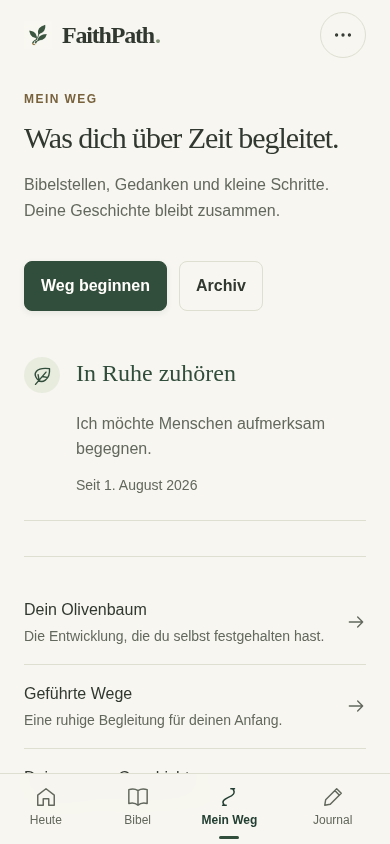
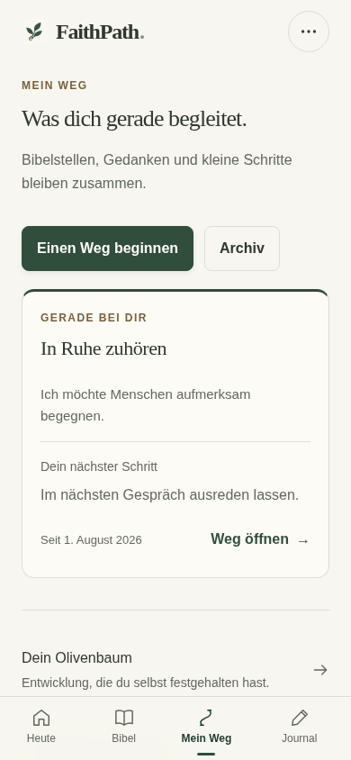
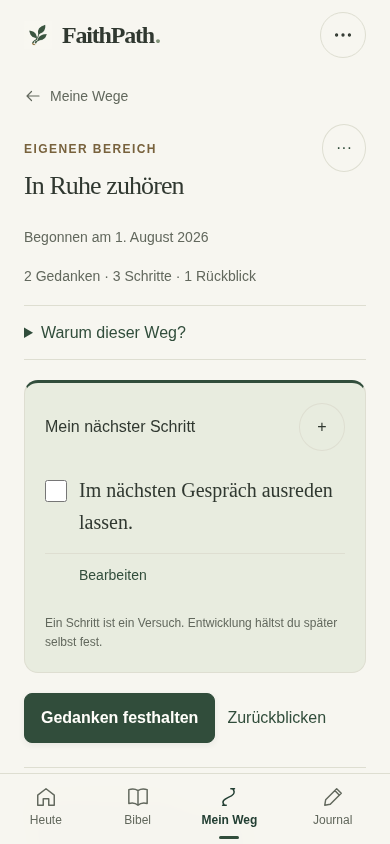
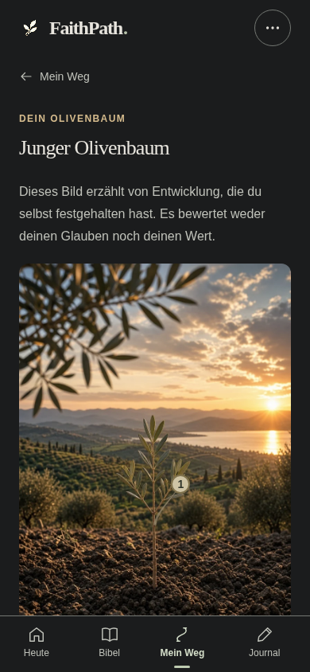
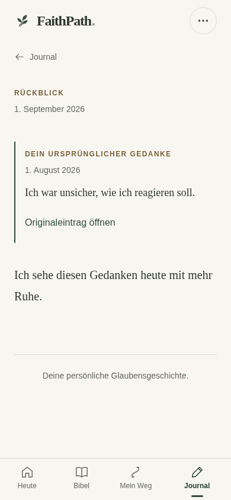

# FaithPath UI/UX Phase 3 – Implementierungs- und Abnahmebericht

Stand 16.10.2026. Kandidat für isolierte Geräteabnahme; keine Produktionsfreigabe.

## Ergebnis

Phase 3 ist im Code umgesetzt: „Mein Weg“ zeigt einen tatsächlichen nächsten Schritt; einzelne Wege verbinden Anlass, Gedanken, Bibelstellen und echte Geschichte; der Olivenbaum erklärt belegte Entwicklung und erhält Zugang zu vorhandenen Wegen; Rückblicke behalten ihren richtigen historischen Bezug. Der bestehende Vanilla-JS-PWA-Stack bleibt erhalten. Keine neuen Inhalte, Fragenimporte, Datenmigrationen oder Laufzeitabhängigkeiten.

**Freigabeempfehlung: GO für isolierte Preview und physische Geräteabnahme. NO-GO für Produktion.** Die echten iPhone-/Safari-/Home-Screen-PWA-/VoiceOver-Gates von UIUX1, UIUX2 und UIUX3 sind weiterhin OFFEN. Chromium-Prüfungen und simulierte Viewports ersetzen diese Tests nicht. Weder main noch Produktion wurden geändert; es gab keinen Netlify-Deploy und daher keinen neu veröffentlichten Preview-Link.

## Tatsächlich geprüfter Stand

Repository `akwasiacheampongma-code/Faithpath-`; Arbeitsbranch `feature/uiux-phase3-personal-journey-tree-20261016`.

- Basis `574687ad4d1c55dcf226113f96838929fc656a84`: verbindliche Phase 3-Spezifikation auf UIUX2-Code; UIUX2-Ausgangscommit `f500bce97e0eb4cb72908b29ca060b86e631d507`.
- A Übersicht `458bc80`; B Einzelweg `f740f7a`; C Baum `db2605a`; D Rückblicke `93470b9`.
- Separater nachgewiesener Kurzkapitel-Fix `ea86ece`.
- Abschließende Quellen-/Legacy-Korrekturen und Integrationstests: **Implementierungscommit `f6f857d8c88affcd20872cac0c8e8c3a8a3910f0`**.
- Der nachfolgende QA-/Dokumentationscommit verändert keine Build-Eingaben. Finaler Branch-HEAD und äußere Dateihashes stehen im separaten Lieferbeleg.
- Build-ID **`FP4-20261016-G-STABLE1-UIUX3`**.
- Build-Hash **`5e554bb230055879ccfa457d75d887e1e28eaca7928291875fe41ee801c7f7f1`**.
- Content-Hash **`8630cf25034cbd8ee28060b2318addc25d26611317439d08ac2fa5cae938e309`**, unverändert zur Basis.

## A – Mein Weg

Die Übersicht übernimmt die bestehende priorisierte Today-Auswahl. Weitere Wege bleiben stabil in gespeicherter Reihenfolge; archivierte Wege sind getrennt zugänglich. Jede Karte zeigt den echten offenen Schritt, persönlichen Kontext und „Weg öffnen“. Eine zusammenhängende Kartenverknüpfung vermeidet verschachtelte konkurrierende Klickziele. Ohne Weg bleibt der Beginn freiwillig. Keine neue Navigation, Fortschrittsquote oder spirituelle Bewertung.

Vorher erforderte der nächste Schritt das Öffnen des Wegs. Jetzt steht er direkt auf der Karte. Lange Begründungen bleiben als Vorschau begrenzt; der vollständige Wortlaut ist im Weg erreichbar. Auf 320×568 benötigen umfangreiche Inhalte normalen vertikalen Scroll; Texte werden weder verkleinert noch in horizontalen Scroll gedrängt.

## B – Einzelner Weg

Vier vorhandene Aspekte sind klar gegliedert: Warum dieser Weg? Mein nächster Schritt. Was mich begleitet. Meine Geschichte. Der aktuelle Schritt bleibt bewusst abhackbar; weitere und frühere Schritte sind erreichbar. Bestehende Editier-, Priorisierungs-, Archivierungs-, Lösch- und Undo-Aktionen bleiben maßgeblich.

Letzte Originalgedanken und echte Bibelstellen öffnen ihre tatsächliche Quelle. Ein Reader-Einstieg trägt den Weg als Rückkehrkontext. Die Geschichte verwendet bestehende Domain-/Kontinuitätshelfer, schließt echte global verknüpfte Rückblicke ein und unterdrückt Journal-/Reflexionsspiegel einschließlich älterer Text-/Datum-Spiegel ohne explizite ID. Sie lädt in 40 er-Schritten weiter; der Test erreicht alle 97 synthetischen Gedanken. Historische Datumsangaben und Quellen werden nicht erfunden.

Nach Schrittabschluss erhält der nächste sinnvolle vorhandene Schritt beziehungsweise seine Überschrift Fokus. „Weitere Momente“ führt Tastaturnutzer zum ersten neu geladenen Moment. Direkte Schrittverknüpfungen öffnen die konkrete vorhandene ID, auch innerhalb früherer Schritte.

## C – Olivenbaum

Alle sieben Originalgrafiken, Stufen und Schwellen bleiben unverändert:0,1,2,3–4,5–6,7–9,10+. Die vorhandene Zweigzuordnung bleibt die einzige Quelle nummerierter Marker. Persönliche Wege ohne Zweigbeleg sind textlich erreichbar; auch frühe Stufen und archivierte Wege verlieren ihren Zugang nicht.

Die Darstellung verwendet vollständig erhaltene Motive, ruhige Begrenzung der Szenengröße und bestehende Theme-Farben. Die Liste „Was hinter dem Baum steht“ nennt ausschließlich dokumentierte Entwicklungsmomente mit ursprünglichem Text und vorhandenem Datum. Unbekannte Angaben bleiben unbekannt. Rückblicke beziehungsweise zugehörige Wege sind direkt erreichbar.

Der Baum bewertet weder Glauben noch persönlichen Wert. Schritte, Quiz und Bibelkapitel verändern seine Stufe nicht automatisch. Das Schwert bleibt das unveränderte Symbol der Bibelreise. Archivierung bewahrt dokumentierte Entwicklung; endgültiges Löschen und Rückgängig folgen der bisherigen Domainlogik, einschließlich Erhalt eigenständiger Gedanken/Markierungen und Schutz vor Überschreiben neuerer Änderungen.

## D – Rückblicke und richtige Originale

Der Rückblick-Editor nutzt die bestehenden freiwilligen Statusauswahlen und Speichertransaktionen. Nur „verändert“ mit ausdrücklich gesetzter Entwicklungsbestätigung erzeugt den bisherigen Entwicklungsnachweis. Ein Statuswechsel nimmt die Bestätigung wieder zurück; ein normaler Gedanke oder Schrittabschluss erzeugt keinen.

Neue Weg-Rückblicke halten den beim Öffnen beziehungsweise bei der fälligen Einladung tatsächlich gezeigten Bezug als optionale `sourceSnapshot`-Metadaten auf dem bestehenden Rückblick fest. Das umfasst ursprünglichen Text, Zeitpunkt, Quellschlüssel und konkrete Schritt-ID, sofern nachweisbar. Ein später anders formulierter oder als nächster gewählter Schritt ersetzt diesen Bezug nicht. Entwürfe nehmen ihn über die vorhandenen Argumente mit.

**Datenvertrag ehrlich eingegrenzt:** V5, Speicherschlüssel, Store, Import und Migrationen sind unverändert. Neue Rückblickdatensätze enthalten additive optionale Metadaten; deshalb wird kein vollständig identischer neuer Record-Aufbau behauptet. Ältere Datensätze bleiben unverändert und benötigen keine Migration. Export/Import dieser Metadaten, parallele Bearbeitung und Quota-Fehler wurden geprüft.

Journal-/Reflexionstexte werden nicht historisch dupliziert. Bei nachträglicher Bearbeitung erscheint ein ehrlicher Hinweis. Neue Einladungen speichern hierfür nur `sourceAt`. Ältere Weg-Rückblicke ohne damaligen Wortlaut zitieren keinen heutigen Ersatzschritt. Eindeutige Markierungsquellen erhalten einen exakten Original-Link ohne erfundenen historischen Text. Gelöschte/mehrdeutige Quellen werden entsprechend gekennzeichnet. Ein ausdrücklich festgehaltener Wegbezug bleibt Teil des Rückblicks, entsprechend der bestehenden Löschsemantik.

## Separat nachgewiesener Reader-Fehler

Der offene Verdacht wurde mit echter Hash-Navigation aus tief gescrolltem Johannes 3 und Entdecken nach Psalm 117 geprüft, jeweils OTB und Luther 1912. Auf 320/390/430 bestanden zunächst alle 12 Fälle; eine pauschale Änderung der Scrollkoordinaten wäre daraus nicht gerechtfertigt gewesen.

Auf 1440×1000 scheiterten dagegen alle 4 Ausgangsfälle: Die seitliche Navigation begann bei y 110 und wurde irrtümlich als untere Lesegrenze verwendet. Das tatsächlich sichtbare Kapitelende bei etwa y 637 wurde als anfangs nicht sichtbar eingeordnet; der bestehende Kapitelende-Observer zählte daraufhin Psalm 117 bereits beim Öffnen.

`chapterOpeningBottom` unterscheidet jetzt dieselbe tatsächliche untere Footer-Geometrie wie der vorhandene Observer. Bei einer seitlichen Navigation gilt die Viewporthöhe. Keine Änderung von `initiallyVisibleChapterEnd`, historischen Ereignissen, Zähllogik oder Schwertdarstellung. Final 20 Fälle bei 320/390/430/768/1440 bestanden: Navigation allein zählt nicht, bewusste Erkundung zählt genau einmal. Ausgangsfehler und Messwerte sind als Belege beigefügt.

## Qualität und Nachweise

**166 Unit-Tests bestanden, 760 reale Chromium-Browserfälle bestanden, acht Update-Prüfpunkte bestanden.** Das sind gezählte Fälle mit teils mehreren Assertions, keine Aussage einer vollständigen Fehlerfreiheit. Alle persönlichen Testdaten sind synthetisch.

| Suite | Fälle | Ergebnis |
|---|---:|---|
| Bestehende Kernabläufe | 12 | PASS |
| Stabilisierung / Entwurfsschutz | 12 | PASS |
| Kapitelquiz-Einstiege | 17 | PASS |
| NT-Master / Browserstichprobe | 24 | PASS |
| Nachlese-Korpus / Browserstichprobe | 36 | PASS |
| MC-Legacy-Fixtures | 6 | PASS |
| Service Worker | 3 | PASS |
| UIUX1 Heute | 130 | PASS |
| UIUX1 Textvergrößerung | 2 | PASS |
| UIUX2 Reader / Geschichten / Schwert | 24 | PASS |
| UIUX2 Stress | 40 | PASS |
| UIUX2 Kurzkapitel | 12 | PASS |
| Bestehende Journey / Baum / Import | 18 | PASS |
| Bestehende tiefe Daten-/Bedienabläufe | 15 | PASS |
| Bestehende axe-Prüfungen | 15 | PASS |
| Kontinuität / Originale mit UIUX2-Kontrolle | 24 | PASS |
| Bestehende Zweig-/Theme-Matrix | 56 | PASS |
| UIUX3 Übersicht | 56 | PASS |
| UIUX3 Einzelweg / Legacy / Pagination | 32 | PASS |
| UIUX3 Baum / sieben Stufen / Undo | 72 | PASS |
| UIUX3 Quellen / Status / Entwurf / Quota | 72 | PASS |
| Kurzkapitel aus gescrollter Navigation | 20 | PASS |
| UIUX3 vier Themes / 200% / Safe Areas | 60 | PASS |
| Komplette Geschichtenreflexion → Baum | 2 | PASS |

Die Inhaltsvalidatoren prüfen den vollständigen Bestand und den freigegebenen NT-Master:1.300 Fragen,260 Kapitel,27 Bücher; alle 2.314 Nachlese-MC-Fragen; gemeinsame Zuordnungen und Reflexionen erhalten. Browserprüfungen sind gezielte Stichproben, keine manuelle Beantwortung sämtlicher Fragen. Die bestehenden redaktionellen Validatoren nennen historische Änderungen gegenüber ihren eigenen früheren Basen; diese Phase hat keine Inhaltsänderung vorgenommen.

Die Fachregressionen umfassen Today/UIUX1, Reader/Geschichten/Schwert/UIUX2, Markierungen/Notizen, Wege/Schritte, Rückblicke, Entwürfe, Konflikte, Import/Export, alle sieben Baumstufen, Löschen/Undo, beide Offline-Bibeln, Service Worker und Update. Axe/WCAG-Prüfungen sind automatisierte Stichproben; keine VoiceOver-Zertifizierung.

Beim älteren Stabilisierungstest wurde allein die absichtlich veränderte CTA-Beschriftung durch den unveränderten `new-path`-Aktionsselektor ersetzt; sämtliche Entwurfsassertionen bleiben. Neue End-to-End-Testselektoren wurden an das tatsächliche Hauptmenü und das bestehende Feld `storyId` angepasst. Die ältere Kontinuitätssuite erwartete noch 210px Baumhöhe und eine Hinweisreihenfolge aus der Zeit vor UIUX1. Beide Annahmen scheiterten identisch am unveränderten UIUX2-Ausgangsbuild. Die finale Prüfung vergleicht diese Werte direkt mit dem eingefrorenen UIUX2-Kontrollbuild; das Heute-Layout wurde nicht angepasst. Die neue Historienprüfung grenzt ihre Dublettenassertion auf die Zeitlinie ein, da der Original-Link im Rückblick-Kontext zusätzlich gewollt ist, und prüft nun auch Legacy-Spiegel ohne Verknüpfungs-ID. Solche anfänglichen Testtreiberfehler werden nicht als Produktfehler ausgegeben. Finale Ergebnis-JSONs und die Rohprotokolle sind getrennt nachvollziehbar.

## Offline und echtes Update

UIUX2 wurde mit fest geprüftem Ausgangshash auf derselben isolierten lokalen Origin installiert. Danach wurde UIUX3 bereitgestellt, das Dokument wirklich neu geladen, das Updateangebot abgewartet und bewusst aktiviert. Bis zur Aktivierung blieben gespeicherte Daten unverändert; anschließend ebenfalls.

Verglichen wurden persönliche Speicherbytes, bereits ausgeführte V3→V5-Migration, alle 260 Kapitel-Fortschrittsschlüssel plus Storyfortschritt, alte Ereignisse, Journal-/Wegverknüpfungen, Markierungen und offener Entwurf. Nach Offline-Reload funktionierten beide Übersetzungen mit unterschiedlicher Johannes 10-Verssegmentierung, neue Wege-/Baumansichten und CSS, Nachlese, NT-Kapitelquiz und Schwert. Entwurf offline fortgesetzt/gespeichert, alte Fortschrittsmetadaten erhalten. Das ist ein echter lokaler Chromium-PWA-Test, kein physischer iOS-Nachweis.

## Visuelle Prüfung

126 echte Vorher-/Nachher-Paare,336 Original-PNGs einschließlich Langseiten. Identische synthetische Fixtures und feste Zeit;320×568,390×844,430×932; Hell und Nacht; tatsächliche Archivliste, leere/aktive/viele/lange Wege, einzelne Wege, Rückblicke und alle Baumstufen. Alle sechs Kontaktbögen gesichtet, zusätzlich Originalansichten/volle Seiten geprüft. Atmosphärisch/Papier und 200%-Text, synthetische Safe Areas und verkürzter Viewport durch weitere Browsermatrizen geprüft.

Prüfergebnis: Texte bleiben lesbar und umbrechen, Originalmotive werden nicht beschnitten, vorhandene Zweige behalten ausreichende Zielflächen, Dialoge und Aktionen bleiben über vertikalen Scroll erreichbar. Lange persönliche Geschichten werden zugänglich fortgesetzt. Ein kleiner Viewport zeigt erwartungsgemäß einen Ausschnitt der scrollbaren Seite; eine volle Baumgrafik ist auf der Seite verfügbar und wird nicht zur gleichzeitig komplett sichtbaren Miniatur verkleinert.

Die selbständige Vergleichsdatei mit allen 126 eingebetteten Paaren liegt im kompakten Prüf-ZIP. Ein separates Screenshot-ZIP enthält alle 336 Original-PNGs einschließlich Langseiten, jeweils mit Prüfsummen. So müssen nicht sämtliche zusätzlichen Bilddateien früherer Regressionen erneut heruntergeladen werden; deren vollständige Ergebnisdateien und Rohlogs bleiben im Prüf-ZIP enthalten. Die folgenden Beispiele sind echte Browseraufnahmen:

## Reproduzierbarkeit und Schutzgrenzen

Drei Ausgaben sind bytegleich: zwei getrennte Build-Verzeichnisse sowie ein dritter Build aus frischem `git archive` des Implementierungscommits ohne Arbeitskopie und ohne Build-Cache.334 Dateien, veröffentlichte Dateihashes und vollständige Inhaltsdateihashes geprüft. Ein explizites Branch-Metadatum ersetzt im Git-Archiv das nicht vorhandene `.git`; es verändert die Anwendung nicht.

Direkter Dateivergleich gegen Basis:216 bestehende geschützte Dateien geprüft,211 byteidentisch. Zulässige Änderungen an fünf bestehenden Dateien: App-Adapter, Reader-Fix, Build-ID, HTML-Stylesheet-Einbindung und Build-Pfadumschreibung. Fünf neue reine Ansichts-/Kontextmodule beziehungsweise Scoped-CSS. Sämtliche Daten, IDs, Inhalte, Tree-Assets, Domain-/Store-/Kontinuitätslogik, Today-Module, Reader-Styles, Schwert und Service-Worker-Protokoll unverändert. Alle Inhaltsdateien werden zusätzlich über denselben Content-Hash gebunden.

Das Build-ZIP enthält den fertigen Netlify-kompatiblen Stand direkt in seiner Wurzel; kein Quellcode-ZIP, kein Hosting-Upload. ZIP-CRC, Dateianzahl, jede enthaltene Datei und externe SHA-256 werden nach dem Packen geprüft. Der Lieferbeleg bindet Commit, Build, Content-Hash, ZIP/PDF und finalen Branch-HEAD. Reproduktionsbefehle: `REPRODUZIEREN.md`.

## Fehler und Review

P2 behoben: falsche Kurzkapitel-Einordnung bei Desktop-Seitennavigation; ältere Spiegel doppelt in neuer Historie; vorhandene Markierungsquelle irreführend als fehlend. Zusätzlich bestehende Leerzustandskonvention und Fokus nach Schrittänderung wiederhergestellt. Reproduzierbare RED-/Vorher-Belege und grüne Gegenprüfung enthalten. Ein unabhängiger lesender Whole-Branch-Review hat beide späten Quellen-/Legacy-Befunde nachgeprüft; keine weiteren konkret nachgewiesenen materiellen Probleme im gelesenen Diff. Dieser Review ersetzt keine Integrationstests.

Kein offener P0/P1 in den ausgeführten finalen Prüfungen. Verbleibende Risiken: physisches iOS-Verhalten, echte Tastatur/Browserleisten/VoiceOver, langfristige iOS-Speicherpersistenz und nicht vollständig rekonstruierbare historische Quellen. Legacy-Wortlaut wird deshalb ausdrücklich nicht erfunden. Rein lokale Daten brauchen weiterhin persönliche Backups. Zusätzliche optionale Review-Metadaten benötigen Speicher; Quota-Fehler müssen Entwürfe bewahren und dürfen keine Entwicklung vortäuschen, was getestet wurde.

## Übergabe und nächste Freigabe

Architektur und Datenvertrag stehen in `docs/UIUX_PHASE3_ARCHITECTURE_2026-10-16.md`; vollständige manuelle Checkliste in `docs/UIUX_PHASE3_IPHONE_GATE_2026-10-16.md`. Das Prüf-ZIP enthält synthetische gültige V5-Backups, Screenshots, Ergebnisdateien, Rohlogs, Quellpatch und Reproduktionshilfen. Physisches Geräteergebnis mit Modell, iOS-Version, Build, Origin und Fallprotokoll dokumentieren.

**Nächster Schritt: isolierte Geräteabnahme von UIUX1–3.** Keine automatische Veröffentlichung, kein Main-Merge, keine neue Design-/Fragen-/Featurephase vor belastbarem Geräte-Gate. Ein grundlegender Umbau ist für diese Phase nicht erforderlich.
