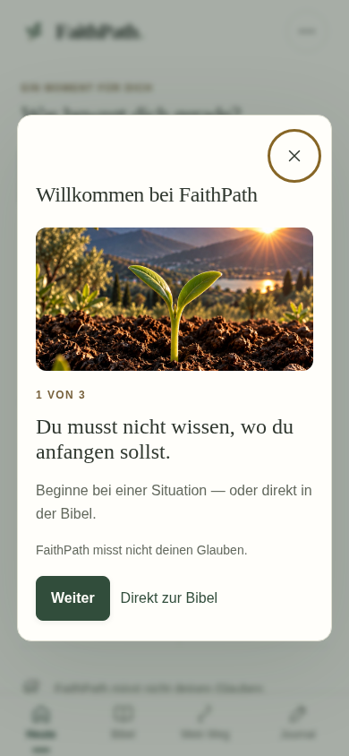
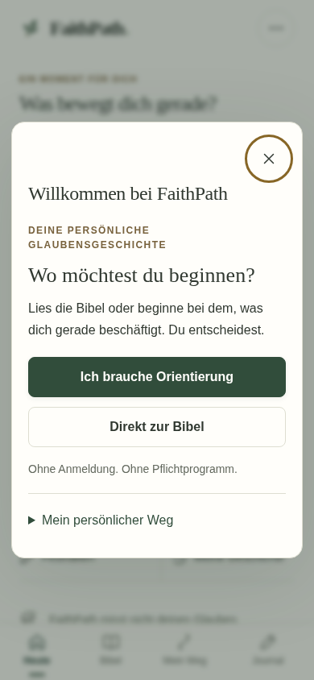
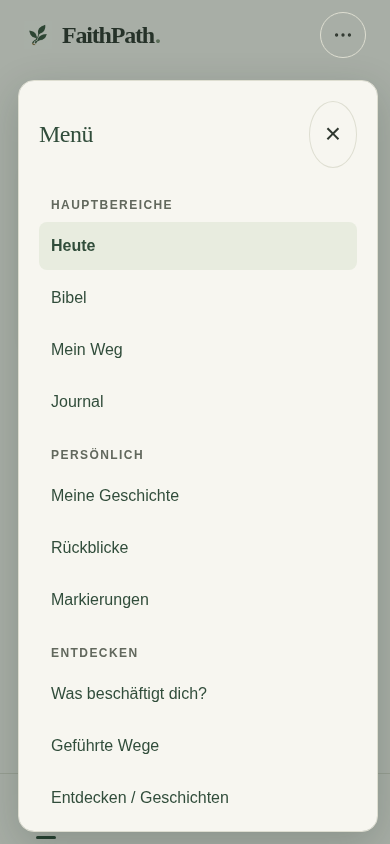
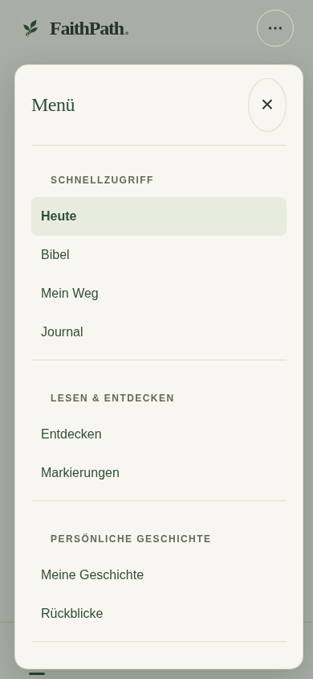
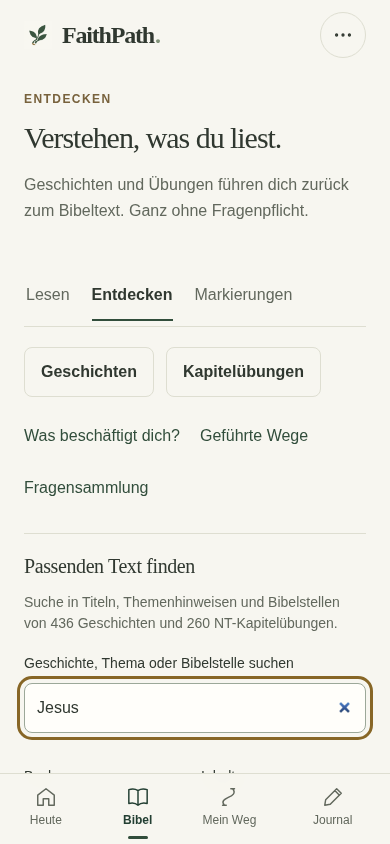
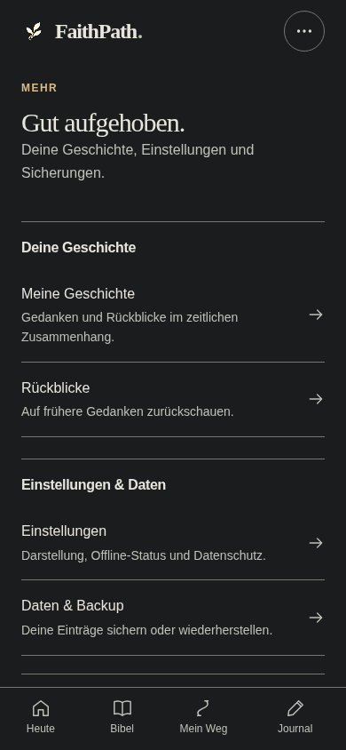

# FaithPath – UI/UX Phase 4: Implementierung und QA

Stand: 16.10.2026. Repository: akwasiacheampongma-code/Faithpath-. Arbeitsbranch: feature/uiux-phase4-navigation-discover-onboarding-20261016.

## 1. Ergebnis und Freigabeempfehlung

Phase 4 ist im Code umgesetzt: ein vereinfachtes Hauptmenü, ein auf sekundäre Aufgaben begrenztes Mehr, eine lokale Suche mit Filtern und schrittweiser Ergebnisanzeige sowie ein kurzer, neutraler Ersteinstieg mit zwei unmittelbar nutzbaren Wegen. Die vier Hauptbereiche Heute, Bibel, Mein Weg und Journal bleiben bestehen. Es wurde kein Framework, Speichersystem oder Inhaltsbestand ersetzt.

**GO für die isolierte physische Geräteabnahme. NO-GO für eine Produktionsfreigabe.** Die echten iPhone-/Safari-/installierte-PWA-/VoiceOver-Abnahmen der Phasen 1, 2, 3 und 4 sind weiterhin OFFEN. Chromium, axe und simulierte Safe Areas belegen diese Geräteabnahmen nicht. Es gibt keinen neuen veröffentlichten Preview-Link: kein Netlify-Deploy und kein Merge nach main wurden ausgeführt.

Die finale automatisierte Auswertung umfasst **174 erfolgreiche Unit-Tests, 984 erfolgreiche Browserfälle in 32 Suiten, acht erfolgreiche Prüfpunkte eines echten Service-Worker-Updates und 104 Vorher/Nachher-Bildpaare**. Zusätzlich dokumentiert die Routenprüfung 344 einzelne Deep-Link-Aufrufe. Die 344 Aufrufe sind Bestandteil der Browsersuiten, keine zusätzlich addierten Testfälle. Ein erfolgreicher Build allein ist ausdrücklich kein Beweis eines fehlerfreien Produkts.

## 2. Versionsstand und nachvollziehbare Commits

Ausgangsstand: 19ce34395570b28d6cb5235888b51c596af5b06c. Er enthält die verbindliche Phase-4-Spezifikation auf UIUX3, dessen HEAD 192675a6a7f602b7abf70d1df5e27b988066c980 ist. Der Ordner des wiederverwendeten isolierten Worktrees heißt weiterhin Faithpath-uiux-phase3; sein tatsächlicher Branch ist Phase 4.

- A – Navigation: ccec047, vereinfachte sekundäre Ziele und Fokusführung.
- B – Entdecken: 9ef4acd, öffentlicher Suchindex und begrenzte Ergebnisanzeige.
- C – Onboarding: 1b2466d, zwei sofortige neutrale Einstiege.
- Integration: **3e3ebc8f44686bd903b4065329dcf284e4d1fb91**, Alt-Klick-Fokuskorrektur und finale Build-ID.

Der Build ist exakt an den letzten genannten Anwendungscode gebunden. Der spätere Abschlusscommit enthält Testpflege, Berichte und Nachweise; er verändert keine Build-Eingabedatei. Der endgültige Branch-HEAD und die geprüften Remote-Refs stehen im separaten Lieferbeleg. Die Commits enthalten Skip-Netlify-Kennungen; der Abschlusscommit überspringt zusätzlich CI. Keine automatische Veröffentlichung wurde ausgelöst.

## 3. A – Navigation und Mehr

Der Drawer zeigt neun statt zwölf Links, gegliedert nach Schnellzugriff, Lesen & Entdecken, persönliche Geschichte sowie Einstellungen & Daten. Die drei bisherigen Direktziele Orientierung, geführte Wege und Fragensammlung liegen im vorhandenen Entdecken-Hub. Damit brauchen sie ab geöffnetem Drawer zwei statt eines Schrittes. Alle anderen alten Ziele bleiben unmittelbar im Drawer erreichbar. Diese bewusste Abwägung reduziert Redundanz und erhält sämtliche Ziele und alte Direktadressen.

Mehr ist kein zweites vollständiges Hauptmenü mehr. Es bündelt Meine Geschichte, Rückblicke, Einstellungen, Daten & Backup und die erneut aufrufbare Einführung. Die vorhandenen getrennten Einstellungs- und Datenansichten bleiben über more?section=settings und more?section=data erreichbar.

Die vollständige Zwölf-Ziele-Matrix steht in docs/UIUX_PHASE4_NAVIGATION_MAP_2026-10-16.md. Im Browser wurden alle zwölf Ziele tatsächlich über die neuen Einstiege geöffnet. Hinzu kommen 43 bestehende Routenvarianten bei vier Bildschirmgrößen in Hell und Nacht: insgesamt 344 Aufrufe mit Prüfung des passenden aktiven Menübereichs und unveränderter persönlicher Daten außerhalb der vorhandenen Leseereignisse.

Der Drawer verwendet den bestehenden Menüadapter und Router. Seine Modal-Semantik, Hintergrund-Inertheit, Tastaturfalle und erreichbare Schließleiste sind geprüft. Escape und Overlay stellen den Fokus wieder her; nach echter Navigation liegt er auf der neuen Hauptüberschrift. Gleiches Ziel und Modifikatorklicks lassen ihn nicht in geschlossenem Markup zurück.

## 4. B – Entdecken, Suche und Filter

Ein einmalig aufgebauter öffentlicher Suchindex verwendet ausschließlich die bestehende Runtime-Zuordnung. Er umfasst **436 Geschichten und 260 NT-Kapitel-Einheiten**. Titel, Themenhinweise, Bibelstellen und bestehende Reflexionstexte bilden den bisherigen Suchraum; private Journaltexte werden weder indexiert noch für Empfehlungen verwendet.

Statt sofort 696 Ergebnisse zu rendern, zeigt die Seite anfangs 20 und danach jeweils bis zu 20 weitere. Die echte DOM-Messung am unveränderten UIUX3 und am Kandidaten bestätigt 696 gegenüber 20 anfangs gerenderten Ergebniszeilen. Das ist ein belegter Größenvergleich, kein behaupteter Geschwindigkeitsbenchmark.

Die Reihenfolge bleibt deterministisch. Vollständige Browserdurchläufe erreichen alle 696 Ziele ohne Dopplungen; bei Geschichten- und Kapitel-Filtern wurden auch alle 436 beziehungsweise 260 Einträge durchlaufen. Die vollständige Trefferzahl bleibt sichtbar. Filterwechsel setzt die Anzeigegrenze zurück. Suchfeld, Filter und Live-Status bleiben bei Eingaben erhalten; Weiterladen fokussiert das erste neu hinzugefügte Ergebnis. Null Treffer bieten eine echte Rückkehr durch Zurücksetzen.

Suche normalisiert Unicode, Groß-/Kleinschreibung und Leerraum. Buch- und Inhaltsfilter, Umlaute, schnelle Wechsel, lange Eingaben, leere Ergebnisse, HTML-Escaping, Tastatur und Browser-Zurück sind geprüft. Im laufenden App-Kontext bleiben Filter bei Rückkehr erhalten; Reload setzt sie bewusst zurück. Es gibt keinen neuen Persistenzschlüssel.

Geschichten, Kapitelübungen, Was beschäftigt dich?, geführte Wege und die alte Fragensammlung sind klar verlinkt. Die drei bestehenden redaktionellen Geschichten liegen nun in einer optionalen Aufklappansicht nach den Suchergebnissen. Sie werden nicht als individuell berechnete oder beliebte Empfehlungen dargestellt. Der zusätzliche Tap ist der Preis für einen früher erreichbaren Suchbereich.

Die unterschiedlichen vorhandenen Zielrouten bleiben erhalten: Entdecken führt Kapitel-Einstiege zu story/ID; die historische quizzes-Sammlung weiterhin zu quiz/ID. Die Zuordnung gemergter Geschichten zu merged-story/ID ist unverändert. Es wurden keine AT-Ersatzfragen erzeugt und keine Inhalte neu importiert.

## 5. C – Neutraler Ersteinstieg

Die drei Pflicht-Slides sind durch einen kurzen Bildschirm ersetzt. **Ich brauche Orientierung** öffnet die bestehende Orientierung; **Direkt zur Bibel** öffnet den Reader-Einstieg. Beide Aktionen sind bei 390 × 844 sichtbar, ohne freiwillige Details öffnen zu müssen. Es gibt keine Registrierung, Dateneingabe, Glaubensklassifikation oder Pflichtfragen.

Mein persönlicher Weg ist optional aufklappbar. Die Erklärung unterscheidet Olivenbaum als selbst dokumentierte persönliche Geschichte und Schwert als Bibelreise. Keines bewertet Glaubensstärke.

Die vorhandenen onboard-next/onboard-skip-Aktionen, der Schlüssel faithpath.onboarding.v4 und die Legacy-Erkennung bleiben maßgeblich. Auswahl, X und Escape beenden die Einführung; dadurch wird sie beim Reload nicht erneut aufgezwungen. Sie kann aus Mehr und Einstellungen wieder geöffnet werden. Diese Entscheidung bedeutet, dass eine abgebrochene Erläuterung bewusst erneut aufgerufen werden muss.

Die Navigation funktioniert auch, wenn das Schreiben der optionalen Onboarding-Kennung scheitert. Bestandsnutzer, Legacy-Kennung, Nutzer nur mit Lesestand, Back, Reload, Wiederöffnung und Fokusübergang sind getestet. Zusätzlich prüfte der unabhängige Reviewer vollständig verweigerten Speicherzugriff: Johannes 3 blieb mit 36 Versen lesbar. Das ersetzt keine Safari-Speicherprüfung auf einem echten Gerät.

## 6. Architektur und Bestandsschutz

Neue kleine Module: navigation-model.js für Ziele und aktive Bereiche, navigation-view.js für Mehr und gemeinsame Einstiege, discover-model.js für Index/Filter/Begrenzung, discover-view.js für Ergebnisansicht und onboarding-view.js für den Einstieg. navigation-discovery.css ist eng auf die neue Oberfläche begrenzt und im Build versioniert. app.js bleibt der Adapter zu bestehendem Router, Dialog und In-Memory-UI-Zustand; menu.js bleibt der einzige Drawer-Controller.

Keine neuen Abhängigkeiten, kein neuer Store, keine Migration und keine neuen persönlichen Record-Felder. Die vorhandene Vanilla-JS-Architektur wird gezielt ergänzt. Wartungspunkte und Entscheidungen sind in docs/UIUX_PHASE4_ARCHITECTURE_2026-10-16.md beschrieben.

Die Schutzprüfung vergleicht 221 bestehende Produktions-Eingabedateien: **216 bytegleich**, fünf begründete Änderungen in app.js, menu.js, version.js, index.html und scripts/build.mjs. Dazu kommen sechs neue Produktionsdateien. Store, Domain, Import-/Exportvalidierung, Migration, Entwürfe, Today, Reader, Wege, Baum, Schwert, Daten und Service-Worker-Template bleiben bytegleich. Die 228 aktuellen Build-Eingaben sind gegen den eingefrorenen Git-Commit geprüft.

436 Geschichten, 2.314 Nachlese-MC-Fragen und 1.300 finale NT-Kapitelfragen bleiben erhalten. N-IDs, FP-IDs, Geschichtszuordnungen, Quizschlüssel, Bibeltexte und Fortschrittslogik sind unverändert. Inhaltsvalidatoren sind erneut erfolgreich ausgeführt. Historische Inhaltszählungen in älteren redaktionellen Validatorberichten beschreiben deren damalige Referenzstände, keine Änderungen durch UIUX4.

## 7. QA, Offline und reales Update

Die vollständige Suitenmatrix mit Fallzahl und Dateihash steht unter evidence/qa-summary.json. Die Endauswertung prüft jeden Ergebnisstatus, Fehlerlisten und Aktualität der Ergebnisse gegenüber dem finalen Unit-Lauf. Alte Resultate werden nicht als neue Tests mitgezählt. 32 Browser-Suiten umfassen Phase 1 bis 3, Stabilisierung, NT-Quiz, Nachlese-Runtime, Originalverknüpfungen, Export/Import, Drafts, Wege, sieben Baumstufen, Schwert, Reader und die neue Oberfläche.

Der reale Update-Test installiert zuerst den exakten UIUX3-Build und ersetzt danach auf derselben lokalen Origin die App-Dateien durch UIUX4. Er wartet auf das echte Service-Worker-Update und aktiviert es bewusst. Alle persönlichen Speicherbytes bleiben vor Aktivierung erhalten; nach dem Update sind unter anderem 260 Kapitel-Fortschrittsschlüssel, Storyfortschritt, V3-Migration, bestehende Markierung und offener Entwurf erhalten. Erst das anschließende bewusste Speichern verbraucht den eigenen Entwurf.

Offline wurden beide Bibelübersetzungen mit ihren unterschiedlichen Segmentierungen, MC-Antworten, Wiederaufnahme/Speichern, letztes Offenbarungskapitel, Wege, Baum, Schwert und neue Such-/Menü-/Einführungsfunktionen geprüft. Die neue versionierte CSS-Datei ist ausdrücklich Teil der Offline-Prüfung. Zwei unterschiedliche Preview-Adressen wurden nicht als Update ausgegeben.

Die visuelle Matrix verwendet echte Chromium-Aufnahmen bei **320 × 568, 390 × 844, 430 × 932 und 1440 × 900**. Hell und Nacht sind vollständig als 104 Paare dokumentiert; Atmosphärisch und Papier zusätzlich in den vier Themes umfassenden Browsermatrizen. 200 % Textgröße, 44-Pixel-Ziele der neuen Kernaktionen, verkürzte 420-Pixel-Viewports, simulierte Insets, Reduced Motion, Tastatur und axe/WCAG-2.1-AA-Stichproben sind erfolgreich geprüft. Das ist keine pauschale Zertifizierung aller App-Zustände.

## 8. Reproduzierte Befunde und Testpflege

P3: Alt-Klick auf ein Drawer-Ziel schloss das Menü ohne Seitenwechsel und ließ den Fokus auf BODY. Vier Browserfälle reproduzierten den Fehler vor der Korrektur und bestanden danach. Die Änderung erweitert ausschließlich die vorhandene Fokuswiederherstellung um altKey; keine Daten- oder Inhaltsänderung.

Zwei Erwartungen einer alten Produktsuite waren bereits am exakten unveränderten UIUX3 falsch: Nachlese erwartete noch reine Aufdeckantworten statt der längst integrierten MC-Optionen; Today erwartete eine automatische Einsteigerführung statt der neutralen Einstiege aus UIUX1. Diese zwei Fehler sind im Baseline-Protokoll nachgewiesen. Die modernisierte vollständige historische Suite besteht mit 19 Fällen und prüft weiterhin Antworten, Erklärungen, Zuordnungen, Journal, Backups, Offline und persönliche Verknüpfungen. Die Anleitung wird freiwillig gewählt, statt jeden App-Neuling als Glaubensanfänger zu behandeln.

Andere notwendige Testanpassungen betreffen den neuen Mehr-Titel Gut aufgehoben., direkte Einstellungslinks statt geänderter zusammengesetzter Accessible Names und die gewollte Ergebnis-Pagination. Die ursprünglichen fachlichen Assertions bleiben erhalten. Der erste Regressionstreiber enthält deshalb noch zwei fehlgeschlagene Titel-Erwartungen; die vollständigen Core- und Worker-Suiten wurden danach erfolgreich wiederholt. Rohprotokolle bleiben transparent enthalten; maßgeblich sind die finalen Ergebnisdateien in qa-summary.json.

Bei der Bildkontrolle zeigte eine Desktop-Aufnahme nach dem Bibel-Skip noch den vorherigen Bildschirm. Ursache war eine zu frühe Aufnahme direkt nach Dialogschluss, bevor der asynchrone Router fertig war. Der Aufnahmeablauf wartet nun zusätzlich auf #bible und dessen echte Überschrift. Beide vollständigen Bildserien wurden neu aufgenommen; es war keine zusätzliche Produktcodeänderung notwendig.

Der unabhängige Abschlussreview fand keine materiellen Sicherheits-, Daten- oder Barrierefreiheitsblocker; der dokumentierte Alt-Fokusfall wurde reproduziert und korrigiert. Review ist eine zusätzliche Stichprobe, kein Ersatz der vollständigen Endregression.

## 9. Build und Integrität

Build-ID: **FP4-20261016-G-STABLE1-UIUX4**.

Anwendungscode: **3e3ebc8f44686bd903b4065329dcf284e4d1fb91**.

Build-Hash: **e47f25df47195c35bea136093125f5dab9a19937dd557f8606827de56826dea0**.

Content-Hash: **8630cf25034cbd8ee28060b2318addc25d26611317439d08ac2fa5cae938e309** – exakt unverändert gegenüber UIUX3.

Zwei unabhängige Ausgabeverzeichnisse und ein weiterer Build aus einem frischen git-archive des eingefrorenen Commits ergeben dieselben **340 Dateien**, bytegenau. release-integrity.json enthält die 339 Nutzdatei-Hashes; der Build-Hash ist SHA-256 über deren geordnetes JSON-Mapping. Das Manifest selbst ist die 340. Datei. Der äußere SHA-256 des ZIP ist ein anderer Wert und steht separat in den Prüfsummen und im Lieferbeleg.

Das Netlify-kompatible Build-ZIP enthält index.html direkt in der Wurzel, beide Bibeln, alle Inhalte, Header/Redirects, Manifest, Service Worker und Assets. Es wurde nicht hochgeladen. ZIP-CRC, alle Dateihashes und eindeutige Archivnamen werden beim Verpacken geprüft.

## 10. Lieferung und Grenzen

- Preview-Build-ZIP: vollständige statische App, bereit für eine getrennt freigegebene Test-Origin.
- PDF-Bericht und kompaktes Prüfpaket: Berichte, Architektur, Navigationsmatrix, Ergebnismatrizen, Logs, synthetische Fixtures, Quellpatch und Reproduktionshilfen.
- Originalscreenshots-ZIP: 208 Vorher/Nachher-PNGs plus Messprotokolle und internes SHA-256-Manifest. Der eingebettete HTML-Vergleich im Prüfpaket enthält alle 104 Paare ohne externe Ressourcen.
- Separater Lieferbeleg: finaler Branch-HEAD, Codecommit, geschützte Remote-Refs, Build-/Content-/Archivhashes und Gate-Status.
- Geräteanleitung: docs/UIUX_PHASE4_IPHONE_GATE_2026-10-16.md mit synthetischen Szenarien, realem Same-Origin-Update und Protokollschema.

Es sind keine bekannten reproduzierbaren Blocker im getesteten Kandidaten offen. Weiterhin offen sind echte iOS-Speicher-/Lifecycle-Effekte, Bildschirmtastatur und Safari-Leisten, Home-Screen-Installation und Kaltstart, realer Safe-Area-/VoiceOver-Fokus sowie das vollständige physische Update. Die älteren UIUX1–3-Gerätegates sind darin ausdrücklich eingeschlossen. Lokale Browserdaten können durch Geräte-/Browserbereinigung verloren gehen; die vorhandenen Backups bleiben erforderlich.

Empfehlung: genau diesen eingefrorenen Kandidaten auf einer isolierten, ausdrücklich freigegebenen HTTPS-Test-Origin zur Geräteabnahme bereitstellen. Erst nach dokumentiert erfolgreicher UIUX1–4-Abnahme eine Produktionsentscheidung treffen. Weitere Design- oder Funktionsänderungen sind für dieses Gate nicht nötig.

## 11. Ausgewählte echte Aufnahmen

