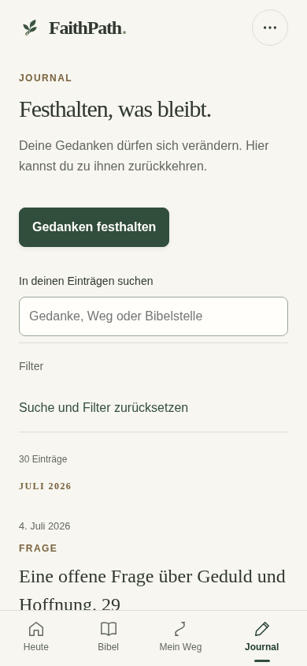
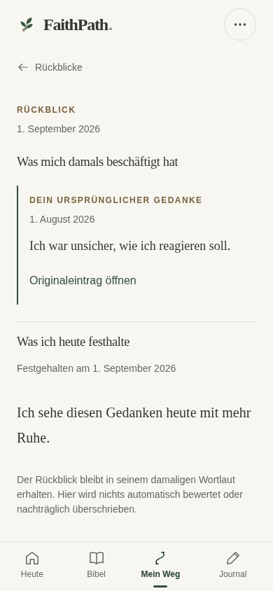
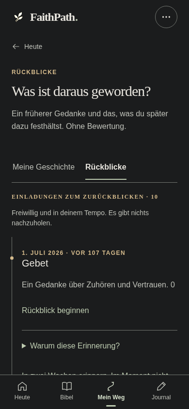
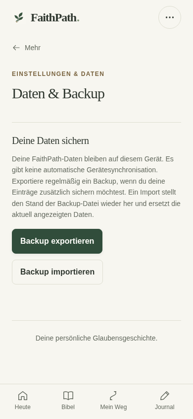
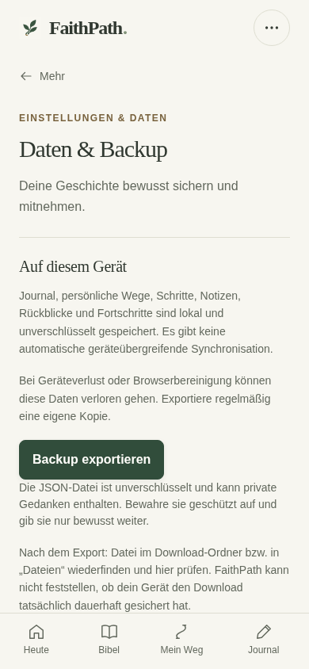

# FaithPath – Phase 5: Implementierung und QA

Stand: 16.10.2026. Repository akwasiacheampongma-code/Faithpath-. Branch feature/uiux-phase5-journal-reviews-backup-20261016.

## 1. Ergebnis und Empfehlung

Phase 5 ist tatsächlich im Code umgesetzt: ein ruhiges Journal mit direktem Schreib-Einstieg und Suche, genaue Rückblicke mit damaligem Bezug und späterem Wortlaut, verständliche In-App-Erinnerungen sowie eine nicht-destruktive Backup-Prüfung mit bewusst zweistufiger Wiederherstellung. Keine neue Cloud, Anmeldung, Abhängigkeit, Gamification oder Datenmigration.

**GO für die isolierte Geräteabnahme. NO-GO für Produktion und einen ungeprüften Gesamtmerge.** Physische iPhone-/Safari-/installierte-PWA-/VoiceOver-Gates der Phasen 1–5 bleiben OFFEN. Der hier gelieferte UIUX5-Build enthält UIUX1–3 plus Phase 5; die separat entwickelte Phase 4 wurde weder verändert noch integriert. Es wurde nichts auf Netlify veröffentlicht und main nicht geändert.

Die Endauswertung bestätigt **180 Unit-Tests, 993 Browserfälle in 33 Suiten, zehn echte Service-Worker-Update-Prüfpunkte und 144 Vorher/Nachher-Paare**. Nur tatsächlich ausgeführte, aktuelle Ergebnisdateien werden gezählt. Die 288 Originalbilder stammen aus Chromium, nicht von einem iPhone. Ein kleiner bekannter P3-Beschriftungsfehler ist unten ausdrücklich beschrieben.

## 2. Tatsächliche Versionsbasis

Ausgangscommit 07656b73068d4c63048df508bc199e817440a688 enthält ausschließlich den Phase-5-Auftrag auf UIUX3@192675a6a7f602b7abf70d1df5e27b988066c980. Der unveränderte UIUX3-Build wurde mit seinem ursprünglichen Branch-Metadatum reproduziert: 334 Dateien, Build-Hash 5e554bb230055879ccfa457d75d887e1e28eaca7928291875fe41ee801c7f7f1.

Die Spezifikation bezeichnet UIUX4 noch als nicht implementiert. Tatsächlich liegt es separat auf bbae3b256fea717b1b5ce35d9d8e27e941128b4f. Dieser Widerspruch wurde geprüft; entsprechend der ausdrücklichen Trennung wurde Phase 5 dennoch direkt von der abgeschlossenen Phase 3 entwickelt. Kein Phase-4-Code wurde hineinkopiert oder gemergt. Deshalb enthält dieser eigenständige Build weiterhin die Phase-3-Navigation, ihre unbeschränkte Entdecken-Liste und ihr Drei-Slide-Onboarding; die Phase-4-Verbesserungen gehören zum späteren Integrationsgate.

Nachvollziehbare Commits:

- A – d95f48f: Journal, klare Suche/Schreibaktion, belegte Verknüpfungen und Rückkehrkontext.
- B – 45f1784: genaue Damals-/Heute-Darstellung und vollständige Rückblickhistorie.
- C – fa2c6d7: freiwillige In-App-Erinnerungen erklären und bestehende Steuerung zeigen.
- D – 012fd38: Backup prüfen, vergleichen, bewusst ersetzen; zwei nachgewiesene Store-Fixes.
- Sicherheitskorrekturen – adb673e: wartende/überholte Wiederherstellungsfreigaben entziehen.
- Letzte Darstellungskorrektur – **e33c139ca46090cdeb74d82b91e20797f0273071**: Bestätigungsaktionen bei 320 Pixeln und 200 % Text erreichbar halten.

Dieser letzte Anwendungscode ist der eingefrorene Buildquellstand. Der endgültige Branch-HEAD ergänzt ausschließlich Dokumentation und QA-Dateien und steht im Lieferbeleg. Alle 231 Build-Eingaben wurden bytegenau gegen den Anwendungscode geprüft. Die Arbeit liegt in einem eigenen Worktree; andere Phasen und main bleiben geschützt.

## 3. A – Journal und persönliche Einträge

Gedanken festhalten ist sowohl leer als auch gefüllt direkt sichtbar. Die Suche liegt offen statt hinter einer zusätzlichen Aufklappstufe. Vorhandene Suchregeln bleiben erhalten: Originaltext, realer Wegtitel und belegte Bibelstellen; kein externer Dienst und kein KI-Lesen persönlicher Gedanken. Typ-/Weg-/Bibelstellenfilter bleiben mit Suche kombinierbar. Es wurde kein neuer Datenindex außerhalb der vorhandenen lokalen Daten oder eine neue Taxonomie eingeführt.

Die schreibfreie Projektion liefert Original-ID, Datum, Typ/Subtyp und tatsächliche Zuordnungen. Unbekannte Legacy-Daten heißen Datum unbekannt und stehen hinter datierten Einträgen; sie erhalten kein künstliches Datum. Karten zeigen einen begrenzten Originaltextauszug und sämtliche echten verknüpften Wege einschließlich Archivstatus. Ein ungültiger Legacy-Bibelbezug erzeugt einen ehrlichen Hinweis statt eines kaputten Reader-Links. Reflexionsspiegel werden nicht zusätzlich als unabhängige Journaleinträge aufgeführt.

Die bestehende 40er-Begrenzung ist erhalten. Der erste neue Eintrag wird nach Weitere Einträge fokussiert. Bei Rückkehr vom geöffneten Eintrag bleiben im laufenden App-Kontext Such-/Filterzustand, Limit, fokussierter Eintrag und Scroll-Kontext erhalten. Es gibt keinen neuen Persistenzschlüssel für UI-Filter; ein Reload setzt diese wie bisher zurück.

Schreiben, Bearbeiten, Verknüpfen, Löschen und Undo laufen weiterhin über vorhandene Transaktionen, Draft-Besitz und Record-Deltas. Ein Gedanke wird nicht automatisch einem Weg zugeordnet. 0/1/30/300 Einträge, lange Texte, zwei Wegverbindungen, unbekanntes Datum, ungültiger alter Bibelbezug, Suche/Reset und vollständige Pagination sind im Browser geprüft. Der unabhängige Review fand in der Journalprojektion keinen weiteren Datenfehler.

Bekannter P3: Nach einem Filterwechsel kann die eingeklappte Beschriftung nur Filter oder noch den vorherigen Typ zeigen. Die aktive Schaltfläche, der tatsächliche Filter, Trefferzahl und Ergebnisse bleiben korrekt; Reset ist erreichbar. Diese kleine Anzeigeabweichung wurde nicht in den sicherheitsrelevanten Fix-Pass aufgenommen und ist eine spätere gezielte Korrektur wert.

## 4. B – Rückblicke: Original und späterer Gedanke

Die Rückblickseite trennt Was mich damals beschäftigt hat und Was ich heute festhalte. Beide Teile erhalten die tatsächlich belegten Daten. Grundlage bleiben allReviews, reviewSourceContext, sourceSnapshot und sourceAt. Weder ein gemeinsamer heutiger Weg noch ein später anderer Schritt wird als damaliger Originaltext eingesetzt.

Bei fehlenden, mehrdeutigen oder nach der Einladung bearbeiteten Quellen erscheint der vorhandene ehrliche Fallback. Weg-Snapshots behalten ihren Wortlaut, auch wenn der Schritt später anders formuliert oder gelöscht wird. Ein Link führt nur zur tatsächlich noch vorhandenen Original-/Schritt-/Weg-ID. Heute bezeichnet den späteren Rückblick; sein konkretes Speicherdatum bleibt sichtbar, auch wenn er nicht am aktuellen Kalendertag entstand.

Statt nur fünf Rückblicke ohne Fortsetzung ist die vollständige vorhandene Historie jetzt in 40er-Schritten erreichbar. 75 Rückblicke wurden ohne doppelte IDs vollständig durchlaufen. Historische Quellen und persönliche Timeline bleiben getrennte Perspektiven; der Journalbestand wird nicht durch Rückblickkarten dupliziert.

Alle vorhandenen Statuswerte und die explizite Entwicklungsbestätigung bleiben unverändert. Nur changed mit aktiver persönlicher Bestätigung erzeugt den vorhandenen Entwicklungsnachweis. Schrittabschluss, Zeitablauf, Lesen oder Quiz werden nicht als Entwicklung gezählt. Die alten vollständigen Review-Regressionsfälle prüfen dies erneut. Es gibt keine neue Funktion zum nachträglichen Bearbeiten oder Löschen historischer Rückblickbelege.

## 5. C – Erinnerungen verstehen und steuern

Fällige Hinweise heißen Einladungen zum Zurückblicken. Warum diese Erinnerung? nennt den vorhandenen Bezug und die letzte belegte Aktivität. Null, eine und zehn Einladungen wurden geprüft; es gibt nichts nachzuholen und keine Pflichtbewertung.

In zwei Wochen erinnern und Im Moment nicht verwenden weiterhin reminderSnoozes beziehungsweise dismissedGaps. Bereits zurückgestellte Quellen sind im Rückblickbereich nachvollziehbar; ein Datum bedeutet frühestens ab diesem Tag beim nächsten Nutzen der App. Ein konkreter unterdrückter Quellschlüssel kann bewusst wieder zugelassen werden, indem ausschließlich die vorhandenen Unterdrückungswerte entfernt werden. Keine neue Preference, kein neuer Scheduler.

Die tatsächliche Fälligkeit bleibt ausschließlich gaps(data,now). Die schreibfreie Übersicht zurückgestellter Quellen fragt dieselbe Domainfunktion ohne Suppression zu einem fernen Abfragezeitpunkt nach zulässigen Quellen und zeigt nur bereits vergangene Originalaktivität. Das löst keine geplante Aktion aus. Archivierte/gelöschte Quellen sowie bestehende Spiegel-Ausschlüsse bleiben damit bei derselben fachlichen Autorität.

Beim Rückblick bleiben 0, 14 und 42 Tage auswählbar. Die App erklärt ausdrücklich: Hinweise erscheinen nur beim Öffnen oder Nutzen; keine Push-, E-Mail- oder Hintergrundnachrichten. Reload, Snooze/Dismiss, erneute Zulassung, Archiv/Deletion und Berliner/Los-Angeles-Zeitzonen sind getestet. Es wurde keine OS-Benachrichtigungsberechtigung angefordert.

## 6. D – Dateiprüfung und bewusste Wiederherstellung

Daten & Backup ist eine eigene kleine View an der vorhandenen more?section=data-Route. Der Mehr-Hub und die Einstellungen wurden nicht für Phase 5 umgebaut. Die Oberfläche erklärt lokale unverschlüsselte Speicherung, fehlende automatische Synchronisation und das Risiko von Geräteverlust/Browserbereinigung. Exportdateien sind unverschlüsselte JSON-Dateien mit möglicherweise privaten Gedanken und sollen geschützt abgelegt werden.

Backup prüfen verwendet exakt denselben prepareImport-/Relations-/Bibelreferenzpfad wie echter Import. Die Grenze bleibt 20 × 1024 × 1024 Bytes. Eine Prüfung zeigt nur Bestandszahlen und ersetzt keinen Main-, Draft- oder Wiederherstellungsstand. Reflexions- und Journalzahlen werden nicht als unabhängige Gedanken addiert. Ein tatsächlicher Exportdownload wurde im Browser gespeichert, gelesen und mit den synthetischen Originaldaten verglichen.

Ein echter Import verlangt erst den Vergleich Aktuell/Datei und danach eine eigenständige letzte Bestätigung. Er ersetzt statt zusammenzuführen. Eine bestehende lokale Sicherheitskopie wird unmittelbar vor dem Schreiben angelegt; sie liegt auf demselben Gerät und ist keine externe Garantie. Beim nächsten Import wird diese Kopie wieder ersetzt. Ein vorhandener Entwurf bleibt bytegleich und kann zum früheren Stand gehören; er kann vorher separat als Datei gesichert werden.

Die App meldet nur Download angefordert. Sie behauptet weder einen verlässlich bestätigten Dateischreibvorgang noch ein garantiertes Letztes Backup. Hilfetext führt zum tatsächlichen Wiederfinden und Prüfen der Datei in Downloads/Dateien.

Fünf konkrete Fehler wurden reproduziert und korrigiert:

| Priorität | Befund vor Korrektur | Nachweis und Korrektur |
|---|---|---|
| P1 | Veralteter Tab exportiert einen älteren Stand als vermeintlich aktuellen Backupbestand | Unit-RED und echter Zwei-Tab-Browserfall; bestehender Store-Frischecheck jetzt auch vor Export und Bestandsvergleich |
| P2 | Fehlgeschlagener Main-Write überschreibt die ältere lokale Wiederherstellungskopie | Unit-RED und Browser-Quota-Test; aktuelle Main-Daten bleiben atomar unverändert, frühere Kopie wird soweit browserseitig möglich zurückgesetzt |
| P1 | Nach Warten auf die Journalsperre importiert eine bereits abgebrochene Bestätigung trotzdem | Unabhängig reproduziert; drei Browser-RED-Fälle für Abbrechen, Escape und Route. Sessionbesitz/Dialog/Status werden innerhalb der Sperre erneut geprüft, danach GREEN |
| P2 | Verspätete Dateilesung ersetzt eine neuere Undo-Bestätigung | Unabhängig reproduzierter Browser-RED; jede neue Prüfen-/Restore-Vorschau übernimmt eine neue Generation, alte Ergebnisse werden ignoriert, danach GREEN |

Neuere Main- oder Draft-Rohbytes entziehen einer bestehenden Vorschau die Berechtigung. Die Endbestätigung ist während des Wartens deaktiviert; Abbruch bleibt möglich. Dieselbe Session kann nur einmal erfolgreich abschließen. Fehlende Speicherberechtigung führt nicht zu einer vorgetäuschten Speicherung. Es wurde keine neue Datenschema- oder Recovery-Migration eingeführt.

Wichtige Grenze: Mehrere localStorage-Operationen sind keine absturzsichere Datenbanktransaktion. Der alte Main-Zustand bleibt bei fehlgeschlagenem atomarem Main-Write bestehen; ein Browserabsturz zwischen separaten Schreibvorgängen oder ein zusätzlicher Fehler bei der Rücksetzung einer Kopie sind nicht pauschal ausgeschlossen. Externe Dateien und echte Geräteprüfung bleiben erforderlich. Kein neuer eigener Speicherdienst wird dafür erfunden.

Die reale Übertragung wurde zusätzlich auf einer zweiten isolierten lokalen Origin ausgeführt: von A tatsächlich heruntergeladene Datei auf B geprüft und importiert; IDs, Inhalte und Fortschritte stimmen, B behält seinen offenen Entwurf, A bleibt unverändert. Das ist eine echte Browser-Origin-Trennung, kein nur simulierter Funktionsaufruf.

Zusätzlicher P2-Darstellungsbefund: Bei 320 Pixeln und 200 % Text verdeckte der haftende lange Backup-Titel den Bestätigungsbutton. Ein echter Click-Timeout reproduzierte das Problem. Zwei ausschließlich auf Backup-Dialoge begrenzte CSS-Regeln lassen den Header natürlich mitscrollen; beide Stufen behalten ihre eigene Abbrechen-/Schließenaktion. Alle 24 Dialog-/Tastatur-/axe-Fälle in vier Themes sind danach grün. Der kurzzeitige native BODY-Fokus beim Durchtabben existiert bereits im exakten UIUX3; das Modal bleibt dabei aktiv und der Hintergrund nicht bedienbar. Die Testkorrektur ist durch ein separates Baseline-Protokoll belegt.

## 7. Architektur und Integrationsstrategie

Neue schreibfreie Module für Journal, Rückblicke, Erinnerungserklärung und Backupansicht verringern die Verantwortung der jeweiligen app.js-Renderfunktionen. Der vorhandene Router, Dialogadapter, Store, Journal-Transaktionen und Draft-Besitz bleiben die einzigen Steuerungswege. journal-reviews-backup.css ist auf die betroffenen Bereiche begrenzt und im PWA-Build versioniert. Vier Themes und globale Styles sind unverändert.

Die Schutzprüfung vergleicht **222 bestehende Build-Eingaben: 215 bytegleich und sieben begründete Änderungen**. Betroffen sind app.js, store.js, version.js, index.html, Build-Skript und zwei alte Inhaltsvalidatoren. Neun neue Source-/Builddateien kommen hinzu. Domain, Continuity, Review-Quellenauflösung, Journal-Transaktion/Undo, Drafts, Today, Reader, Wege, Baum, Schwert, Service-Worker-Template und sämtliche Daten bleiben bytegleich.

Die beiden historischen Nachlese-Validatoren pinnen auch store.js. Ihre notwendigen Sicherheitsfixes wurden daher durch eine enge bekannte Alt-/Neu-Digest-Prüfung zugelassen. Andere Laufzeitänderungen oder Inhaltsdateien bekommen keine Ausnahme. Die historischen Manifeste bleiben unverändert; ein Test lehnt unerwartete neue Digests weiterhin ab. Eine spätere Store-Änderung braucht eine neue explizite Prüfung.

2.314 Nachlese-MC-Fragen, 1.300 finale NT-Kapitelfragen, 436 Geschichten, Bibeltexte, N-/FP-IDs und Fortschrittsschlüssel sind unverändert. Bestehende Validatorausgaben erwähnen frühere redaktionelle Änderungen; sie sind kein Beleg für Inhaltsänderungen in Phase 5. Die Content-Byteprüfung ist hier maßgeblich.

UIUX5_MERGE_MANIFEST.md dokumentiert die konkreten Konflikte: app.js-Imports/Zustand/Handler, more()-Datenadapter gegen UIUX4-Mehr-Hub, Dialog-Lifecycle, menu.js, version.js, beide Stylesheets/Links/Build-Umschreibungen und generierte PWA-Assets. Eine spätere integration/uiux4-uiux5-20261016 ist nur vorgeschlagen, nicht erstellt. Kein ours/theirs-Gewinner: UIUX4-Navigation und UIUX5-Datenpfade müssen gezielt zusammenpassen. Der gemeinsame Build braucht eine neue ID und vollständige Tests beider Phasen plus UIUX1–3 auf demselben Integrationscommit.

## 8. Ausgeführte QA und ehrliche Grenzen

Die finale Matrix mit Ergebnispfaden, Fallzahlen und SHA-256 liegt in evidence/qa-summary.json. Die vollständige funktionale Regression lief auf adb673e. Der letzte Codecommit ergänzt danach ausschließlich zwei Backup-Dialog-CSS-Regeln; sämtliche JavaScript- und übrigen Build-Eingaben sind bytegleich. Alle betroffenen Backup-/Dialog-/Racefälle, vollständigen Core-/Kontinuitätssuiten, 180 Unit-Tests, reales Update und Bildaufnahmen wurden auf dem finalen CSS-Kandidaten erneut geprüft. evidence/style-delta.json weist diese Trennung ausdrücklich nach; nicht jede unbetroffene Suite wurde wegen zweier begrenzter CSS-Regeln erneut ausgeführt. Der Summarizer lehnt fehlende, vor dem funktionalen Unit-Referenzlauf erzeugte oder fehlgeschlagene Resultate ab. 993 Browserfälle aus 33 Suiten umfassen die vollständigen UIUX1–3-Regressionsbereiche sowie neue Journal-/Review-/Reminder-/Backup-/Race-/Stressfälle. Vier Race-RED-Fälle sind separat als Fehlernachweis erhalten, nicht als bestandene Endfälle gezählt.

Nach dem unabhängigen Review wurde der begonnene Vor-Fix-Regressionslauf bewusst gestoppt; dessen Teilresultate zählen nicht als finale QA. Die komplette Suite lief anschließend gegen den korrigierten Kandidaten erneut. Alte Importtests wurden an die zwei ausdrücklich gewollten Bestätigungen angepasst, ohne Datenassertions zu entfernen. Die leere Schreibaktion liegt nun außerhalb der Leerzustandskarte, und die chronologische Rückblickansicht wird anhand der konkreten Original-ID statt pauschal des ersten September-Beispiels geprüft. Der Offline-Entwurfsvergleich wartet auf den Abschluss eigener bereits eingereihter Schreibereignisse, bevor die Byte-Sicherung verglichen wird; keine Draft-Logik wurde dafür geändert. Die direkte Journalsuche ersetzt ihren bisherigen Suchen-Aufklapper; die neue Schreibaktion hat ein sichtbares Label. Weitere ältere Notiz-/Journalprüfungen verwendeten noch „Notiz löschen“ statt der bereits in UIUX3 vorhandenen Rollenaktion „Notiz an der Bibelstelle entfernen“. Die exakte UIUX3-Baseline bestätigt 0 alte und 1 aktuelle Aktion. Diese Suiten wurden vollständig mit den bestehenden Labels erneut ausgeführt. Erfolgreiches Speichern wird am beendeten Editorablauf statt am bereits dahinter vorhandenen alten Text geprüft; ein nach dem Speichern freiwillig geöffneter Folgedialog bleibt erlaubt. Ein durch Import bewusst erhaltener offener Entwurf wird im Test vor einem ausdrücklich gewählten neuen Formular zunächst als echte Datei gesichert und erst dann bewusst verworfen. Keine fachliche Assertion wird dadurch entfernt. Die alte nicht mehr gültige vor-MC-Produktsuite wird nicht als neue erfolgreiche Vollprüfung ausgegeben.

Das reale Service-Worker-Update beginnt mit exakt UIUX3 auf einer lokalen Origin, hält offene synthetische V3/V5-Daten, 260 Kapitel-Fortschrittsschlüssel, weitere Story-Metadaten und einen Entwurf fest, stellt UIUX5 auf derselben Origin bereit und verlangt bewusste Aktivierung. Vor Aktivierung bleiben alle Speicherbytes gleich. Danach funktionieren beide Bibeln mit unterschiedlicher Verssegmentierung, unveränderte Fragen, Reader/Markierung, Wege/Baum/Schwert, neuer Journal-/Reminder-/Backup-Prüfpfad und versionierte Styles offline. Eigener Entwurf wird erst bei bewusster Speicherung verbraucht; neuer Entwurf überlebt Offline-Reload. Zehn Prüfpunkte sind protokolliert. Zwei verschiedene Preview-Adressen werden nicht als Update-Test ausgegeben.

Vorher/Nachher: 144 Paare bei 320 × 568, 390 × 844, 430 × 932 und 1440 × 900, Hell/Nacht. Enthalten sind Journal 0/1/30/300, lange/mehrfach verknüpfte/Legacy-Einträge, Suche/null Treffer, Original-/Snapshot-/edierter Rückblick, 0/10 Einladungen, Timeline, Backup und Entwurf. Atmosphärisch und Papier sind zusätzlich in Funktions- und Stressmatrizen abgedeckt. 200 % Text, verkürzte 420-Pixel-Viewports, simulierte Safe Areas, Tastatur/Fokus, Reduced Motion, Touch-Kernaktionen und axe/WCAG-2.1-AA-Stichproben wurden geprüft.

Das belegt weder ein vollständiges Accessibility-Zertifikat noch echte iOS-Tastatur-, Lifecycle-, Speicherbereinigungs-, WebKit- oder VoiceOver-Eigenschaften. Anleitung und Protokollschema stehen in docs/UIUX_PHASE5_IPHONE_GATE_2026-10-16.md. Die früheren Gerätegates bleiben ausdrücklich offen.

## 9. Reproduzierbarer Preview-Build

Build-ID: **FP4-20261016-G-STABLE1-UIUX5**.

Anwendungscode: **e33c139ca46090cdeb74d82b91e20797f0273071**.

Build-Hash: **cf155e3ef0fabb40928991822edab7649a61d99f3fe94a319c7290e83e323e84**.

Content-Hash: **8630cf25034cbd8ee28060b2318addc25d26611317439d08ac2fa5cae938e309** – exakt identisch zur UIUX3-Basis.

Zwei unabhängige Ausgabeverzeichnisse und ein dritter Build aus frischem git-archive erzeugen dieselben 342 Dateien, bytegenau. Alle 341 Manifest-Nutzdateihashes wurden geprüft; release-integrity.json ist die 342. Datei. Build-Hash ist SHA-256 des geordneten JSON-Pfad-/Hash-Mappings, nicht der äußere ZIP-Hash.

Das Netlify-kompatible ZIP enthält index.html direkt in der Wurzel sowie vollständige Inhalte, Bibeln, Assets, Manifest, Worker, _headers und _redirects. Kein Upload. Äußere SHA-256, innere Datei-Prüfsummen, ZIP-CRC und eindeutige Dateinamen sind geprüft. Reproduktionsbefehle und exakte Branch-Metadaten stehen in REPRODUZIEREN.md.

## 10. Lieferung und nächste Entscheidung

Lieferung: vollständiges Build-ZIP, dieser PDF-Bericht, separates kompaktes Prüfpaket mit Matrix/Logs/Reproduktion/Quellpatch/synthetischen Fixtures/Integrationsvertrag/Geräteanleitung sowie ein Originalscreenshots-ZIP mit 288 PNGs und Messwerten. Der eingebettete HTML-Vergleich enthält alle 144 Paare ohne externe Ressourcen. Lieferbeleg und äußere Prüfsummen verbinden Anwendungscode, finalen Branch-HEAD, Build- und Content-Hash sowie die unveränderten geschützten Remote-Refs.

Keine bekannten offenen P0/P1/P2-Blocker im geprüften eigenständigen Kandidaten. Der P3-Filtertext bleibt dokumentiert. GO für eine isolierte Geräteabnahme; kein Produktions-GO. Danach erst eine ausdrücklich freigegebene UIUX4/UIUX5-Integration mit neuer ID und erneuter vollständiger QA auf deren tatsächlichem Commit. Echte UIUX1–5-Gerätegates müssen vor Gesamtrelease erfolgreich protokolliert sein.

## 11. Ausgewählte echte Aufnahmen

