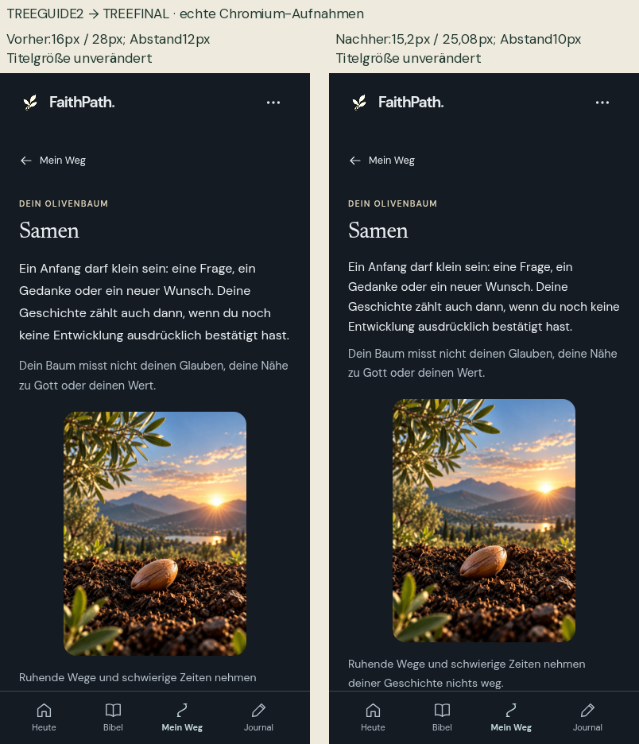
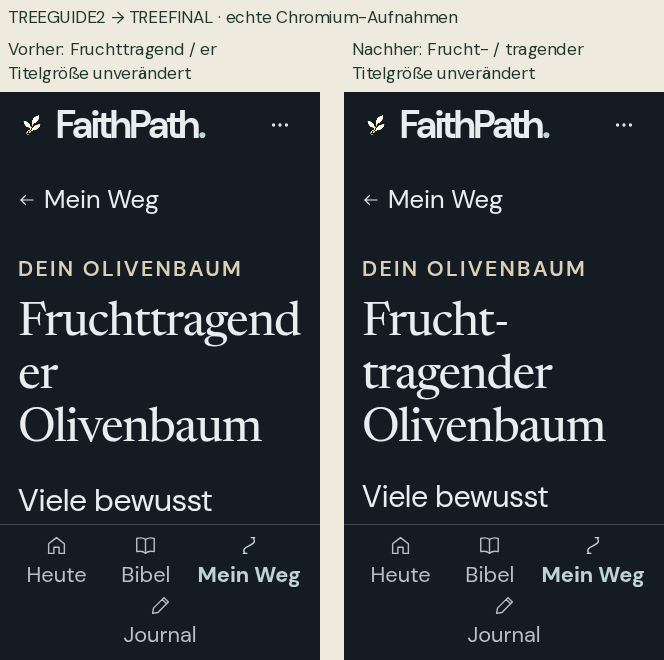

# FaithPath TREEGUIDE2 – Mobile-Final-Fix

18.10.2026. Fortsetzung des akzeptierten Konzepts, ausschließlich zwei Darstellungsfehler korrigiert.

**Ergebnis: GO für die isolierte manuelle iPhone-Abnahme. Keine Produktionsfreigabe.** Kein Merge und kein Deployment. TREEGUIDE2-Branch, MOBILE2, main und bestehende QA-Seite bleiben unverändert. Physisches iPhone, Safari, installierte iPhone-PWA und VoiceOver bleiben OFFEN.

## Exakter Stand

| Nachweis | Wert |
|---|---|
| Separater Fix-Branch | `fix/treeguide2-mobile-final-20261018` |
| Unveränderte Ausgangsbranch-Spitze | `31c96d50a5fb19e76cdb09d7a3b96ae5cb6ad70a` |
| Bisheriger Appcommit | `2b48ae037deeb05100d550522623ecf75ff07224` |
| Neuer, tatsächlich gebauter Appcommit | `ce89422411ec3382c62ba7683167cf1b6db4a457` |
| Bisheriger Build | `FP4-20261018-G-STABLE1-UIUX6D-TREEGUIDE2` |
| Neuer Build | `FP4-20261018-G-STABLE1-UIUX6D-TREEFINAL` |
| Bisheriger Buildhash | `150c015ebb36ea50b1e4c3379eca583f3cf5e73ca963de56ea6f0910aebf5598` |
| Neuer Buildhash | `5390ec0a00ba171bc0f997a5fd5c8ba11b7e58b508a3085c488c21d95add84aa` |
| Netlify-QA-ZIP SHA-256 | `0334b78b8cf0156f8f0f726aabaf4e11b185e8800804ac8011ae117e1924be05` |
| Unveränderter Content-Hash | `8630cf25034cbd8ee28060b2318addc25d26611317439d08ac2fa5cae938e309` |

Der spätere Liefercommit ergänzt ausschließlich QA und Dokumentation; seine exakte SHA und die ZIP-Prüfsummen stehen in der separaten Lieferquittung. Appcommit und Liefercommit sind bewusst getrennt. Der Buildhash ist SHA-256 der geordneten Pfad-/Dateihash-Map, kein ZIP-Hash.

## Fehler 1 – Zwei Absatzregeln trafen die DOM-Struktur nicht

**BESTÄTIGT UND BEHOBEN.** Die Struktur ist `.tree-page > main#main > p`. Beide alten direkten Kindselektoren trafen null Elemente. Daher gewann die allgemeinere `.tree-stage-current-meaning`-Regel mit 1rem/1.75; die persönliche Einordnung behielt ihren bisherigen Abstand. Der frühere Layouttest prüfte Reihenfolge und Überlauf, aber nicht diese berechneten Eigenschaften. Die neue Regression schließt diese Lücke.

Korrigiert in `src/verbunden/personal.css`:

```css
.tree-page > #main > .tree-stage-current-meaning
.tree-page > #main > .tree-personal-meaning
```

Die vorgesehenen Werte wurden im Browser mit `getComputedStyle` geprüft:

| Absatz / Eigenschaft | TREEGUIDE2, 100% | TREEFINAL, 100% | TREEFINAL, 200% |
|---|---:|---:|---:|
| Aktuelle Bedeutung – Schriftgröße | 16px | 15,2px | 30,4px |
| Aktuelle Bedeutung – Zeilenhöhe | 28px | 25,08px | 50,16px |
| Aktuelle Bedeutung – Abstand unten | 12px | 10px | 10px |
| Persönliche Einordnung – Schriftgröße | 14,4px | 14,4px | 28,8px |
| Persönliche Einordnung – Zeilenhöhe | 25,2px | 23,76px | 47,52px |
| Persönliche Einordnung – Abstand unten | 18px | 20px | 20px |

Beide Regeln treffen im unabhängigen Browserlauf jeweils genau einen Absatz. Die vollständige Matrix prüft die effektiven Größen und Abstände für alle 112 Kombinationen. [Messwerte](evidence/after/results.json), [Vorher-Nachher](Vergleich_Absatzregeln_390_100.png).



## Fehler 2 – Unschöner Umbruch des langen Namens

**BESTÄTIGT UND BEHOBEN.** Die generelle Überschriftenregel erlaubte `overflow-wrap:anywhere` und `hyphens:auto`. Im tatsächlich verwendeten Chromium wurde der Titel bei 320/200% und 390/200% ohne sichtbaren Trennstrich als „Fruchttragend / er“ geteilt. Daraus wird keine pauschale Aussage über Safari-Wörterbücher abgeleitet.

`renderTreeJourney` fügt ausschließlich der dargestellten Überschrift eine optionale Trennstelle U+00AD an der deutschen Zusammensetzung **Frucht-tragender** hinzu. Eine baumbezogene Regel verwendet manuelle Silbentrennung, normalen Wortumbruch und keine beliebige Zeichenaufteilung. Der originale Name in `stageNames`, sämtliche Daten und die sieben Erklärungen bleiben unverändert.

Die Überschrift behält exakt ihre bisherige Größe:

| Viewport | 100% Text | 200% Text |
|---|---:|---:|
| 320×568 | 24px | 48px |
| 390×844 | 28px | 56px |

Bei 320/200% erscheint jetzt „Frucht- / tragender / Olivenbaum“. Wenn das Wort Platz hat, wird kein Trennstrich angezeigt. Die native Schrift und eine Prüfung mit blockierten Webfonts ergeben gültige Umbrüche und vollständige, im Viewport liegende Zeichen. Es wurde keine kleinere Titelschrift, keine feste abgeschnittene Höhe und kein neues Verstecken von Überläufen eingesetzt.

Die Chromium-Zugänglichkeitsstruktur enthält weiterhin eine vollständige Überschrift der Ebene1. Ihr String enthält das optionale Trennzeichen; ohne dieses Zeichen entspricht er dem unveränderten Originalnamen. Das beweist keine tatsächliche VoiceOver-Aussprache. [Unabhängiger Befund](evidence/review/independent-review.md), [Vorher-Nachher](Vergleich_Titel_320_200.png).



## Geänderte Dateien

Nur drei App-Dateien:

- `src/verbunden/personal.css`: zwei passende Selektoren und eine auf den Baum begrenzte Umbruchregel.
- `src/tree-view.js`: optionale Trennstelle beim Rendern des Titels; historische Auswahl-/Zähllogik bytegleich.
- `src/version.js`: eindeutige neue Build-ID.

Zusätzlich: ein neuer Titeltest in `tests/tree-stage-guide.test.mjs`, fokussierte Browser-/Update-/Quellprüfungen in `tests/uiux6d-final/`, Sammelskript, Plan und dieser Bericht. [Vollständige Dateiliste](VERAENDERTE_DATEIEN.txt). Keine neue Abhängigkeit, kein Frameworkwechsel und keine neue Migration.

## Tatsächlich ausgeführte Tests

Umgebung: Node24.19.0, Chromium151.0.7922.173 unter Linux, Python3.12.14; vorhandene Playwright-/axe-Abhängigkeiten. Alle Browserprofile enthalten ausschließlich synthetische Fixtures.

| Prüfung | Ergebnis |
|---|---|
| Baseline `npm test` | BESTANDEN: 197/197 |
| Neuer Titeltest vor dem Fix | Erwartet FEHLGESCHLAGEN; optionale Trennstelle fehlt |
| Zwei gezielte Browserzustände vor dem Fix | Erwartet FEHLGESCHLAGEN: Absatzwerte und ungültige Titeltrennung |
| Endgültiges `npm test` am Appcommit | BESTANDEN: 198/198, keine übersprungenen Tests |
| Sieben Stufen × vier Themes × zwei Viewports × zwei Textgrößen | BESTANDEN: 112/112 |
| Native Details/Summary per Enter/Leertaste und unveränderte Speicherbytes | BESTANDEN in allen 112 Matrixfällen |
| Tastatur/axe, 320/200%, 390/100%, 430/100%, Desktop, alle Themes | BESTANDEN: 16/16; vier echte Offline-Reloads |
| Tatsächliches TREEGUIDE2→TREEFINAL-Workerupdate auf einem HTTPS-Origin | BESTANDEN: fünf Prüfungen |
| Ursprüngliche relevante Browserprogramme | BESTANDEN: 15/15, jeweils Exit0 |
| Backup-Lifecycle-Race | BESTANDEN; Hauptdaten/Entwurf/Sicherung unverändert |
| Geschützte Inhalte und Kernmodule | BESTANDEN: 175 Dateien bytegleich |
| Zusätzlicher Quellvergleich | BESTANDEN: 64 Bestandsmodule bytegleich; teilweise Überschneidung mit175 |
| Entwicklungsgrenzen | BESTANDEN: 101 Fälle, 0 bis100 ausdrücklich dokumentierte Entwicklungen |
| Zwei Builds | BESTANDEN: 367 Dateien bytegleich |
| Unabhängiges Review | BESTANDEN: eigene198 Unit-Tests, 8/8 Browserfälle, keine Befunde |
| Echtes iPhone/Safari/installierte iPhone-PWA/VoiceOver | OFFEN |

Die 32 frischen Vorherfälle und die 112 endgültigen Nachherfälle erzeugen je drei PNGs. Weitere Kontrollbilder und Vergleichstafeln sind zusätzlich enthalten; die Bildanzahl ist keine Anzahl unabhängiger Testfälle. [Galerie](screenshots/index.html), [maschinenlesbare Übersicht](QA_SUMMARY.json).

Die ursprünglichen Programme liefen über den unveränderten `tests/uiux6b/run-regression.py` mit dem endgültigen Kandidaten und eigenen Ergebnisordnern. Ausgewählt: core, core-axe, continuity, branches, overview, detail, tree, reviews-original, phase3-stress, journal, reviews, backup, backup-races, backup-dialogs und integration. Deren Geschäfts-/Datenassertions wurden nicht abgeschwächt. Das ist keine Behauptung, sämtliche historischen Skripte des Repositorys wiederholt zu haben. [Einzelne Ausgänge samt Buildbindung](evidence/regression/exits.json).

Die Matrix läuft mit originaler CSP und aktivem Worker. Der getrennte axe-Diagnoselauf verwendet seinen vorhandenen CSP-Bypass. Der unabhängige Layout-/Fallback-Probe blockiert Service Worker, um die Typografie gesondert zu prüfen; er ersetzt den wirklichen Updatelauf nicht.

## Daten, Baumlogik und Update

Alle sieben Namen und Bedeutungen, Originalgrafiken, Bibeltexte, Fragen, IDs sowie sämtliche Domain-, Store-, Import-/Export- und Rückblickmodule bleiben bytegleich. Die drei Appänderungen betreffen ausschließlich Darstellung und Buildkennung. Die bisherige CSS-Datei vor dem Baum-Modul bleibt ebenfalls bytegleich. [Quellvergleich](evidence/module-preservation.json), [Inhalts-/Kernvergleich](evidence/preservation/results.json).

Die bestehenden Schwellen bleiben 0,1,2,3–4,5–6,7–9,ab10. Bibellesen, Quizantworten und abgehakte Schritte erzeugen weiterhin keinen automatischen Aufstieg. Der Renderertest prüft die unveränderten Eingabedaten, der Quellvergleich die unveränderte Zählautorität; bestehende Baum-/Rückblicktests prüfen die historischen Verknüpfungen.

Der tatsächliche Updatetest beginnt mit dem exakt gehashten TREEGUIDE2 auf einer isolierten Loopback-HTTPS-Origin. Er wartet auf beide offline bereiten Bibeln, aktiviert TREEFINAL bewusst und vergleicht alle persönlichen Speicherbytes. Archivierter Weg mit zehn Entwicklungen, Journal, Originalrückblick, Entwurf und Sicherung bleiben erhalten. Offline werden danach der neue Titel, die berechneten Absatzwerte, alle sieben Erklärungen, Grafik und Fonts sowie Psalm52 in beiden Übersetzungen geprüft.

Beim anschließenden Bibellesen dürfen der bisherige Leseort und Lesereignisse wie zuvor fortgeschrieben werden; Entwicklungssumme und persönliche Daten bleiben unverändert. Das ist kein Datenverlust und wird nicht als vollständige Unveränderlichkeit des bewusst benutzten Leseverlaufs ausgegeben. [Updatebeleg](evidence/update/results.json).

Die lokale HTTPS-Prüfung verwendet ausschließlich in ihrem kurzlebigen Testbrowser eine Zertifikatsausnahme für das selbstsignierte Loopback-Zertifikat. Weder die App noch ein persönliches Profil wurden dafür verändert. Kein Remote-Deploy und keine echten Bestandsdaten.

## Visuelle Kontrolle und offene Geräteprüfung

Tatsächlich betrachtet wurden die acht Übersichtstafeln: sieben Stufen in allen Themes bei390/100% sowie320/200%. Zusätzlich wurden die direkten Vorher-Nachher-Bilder und einzelne Originalansichten geprüft. Die native große Schrift bleibt groß; vollständige Texte sind vertikal scrollbar. Es gibt in der automatisierten Matrix keine horizontalen Überläufe. Der zuvor dokumentierte Titel-P3 ist im geprüften Chromium damit behoben.

OFFEN bleiben echte Safari-Silbentrennung und Textvergrößerung, Safari-Seitenzoom, dynamische iOS-Schrift, VoiceOver-Aussprache des optionalen Trennzeichens, Browserleisten/Safe Areas und installierte PWA. Die früheren offenen Gerätegates bleiben bestehen. [Manuelle Abnahme](IPHONE_ABNAHME.md).

## Ehrlich protokollierte Zwischenversuche

Der erste interne Build verwendete versehentlich einen Unterstrich in der neuen Kennung. Der bestehende Validator lehnte ihn korrekt ab; die Kennung wurde auf TREEFINAL geändert. Der Validator wurde nicht aufgeweicht. Ein davon abhängiger Browseraufruf hatte noch kein Manifest und zählt nicht als Produktprüfung.

Ein erster Nachher-Probelauf meldete beim korrekt sichtbaren „Frucht-“ eine vermeintlich falsche Trennung. Ursache war die Testmessung: Der Zeichen-Range nach U+00AD enthält das erzeugte Bindestrichrechteck und das tatsächliche Zeichen auf der nächsten Zeile. `getBoundingClientRect` vereinigt beide; die jetzt verwendete letzte nichtleere `getClientRects`-Position entspricht dem Zeichen. Ein gesonderter Rechteckbeleg und der Screenshot bestätigen das. Es war keine zweite Appkorrektur nötig. Die ursprünglichen Protokolle sind erhalten und werden nicht als bestandene Abnahmen gezählt.

Die erste zusätzliche HTML-Galerieprobe bediente nur den Unterordner `screenshots`, während die Vergleichsbilder im übergeordneten Berichtordner liegen. Das ergab404 und einen Bild-Decodierfehler. Mit dem vollständigen Bericht als Serverwurzel bestand die Probe; die App und die Bilder wurden dafür nicht verändert. Der Konfigurationsvergleich ist im QA-Paket erhalten.

Die vollständigen Unit-Läufe enthalten unveränderte bestehende Content-Hinweise zu Vollkapitelreferenzen und einen npm-Aktualisierungshinweis. Diese Hinweise wurden nicht als neue Baumfehler eingestuft oder redaktionell verändert.

## Reproduktion und Lieferung

```sh
npm test
FAITHPATH_BUILD_BRANCH=fix/treeguide2-mobile-final-20261018 FAITHPATH_BUILD_COMMIT=ce89422411ec3382c62ba7683167cf1b6db4a457 FAITHPATH_OUT=qa-output/uiux6d-final/repro npm run build
node scripts/verify-preview-build.mjs qa-output/uiux6d-final/repro
```

Die tatsächlichen Treiber und Rohprotokolle liegen im Repository beziehungsweise QA-Paket. Der Worker-Updatetest benötigt zusätzlich den unveränderten TREEGUIDE2-Build; die ursprüngliche Kontinuitätsprüfung verwendet ihren UIUX45-Kontrollserver auf Port4450. Keine echten Nutzerdaten verwenden.

- `FaithPath_UIUX6D_TREE_FINAL_Netlify_QA.zip`: vollständiger statischer Kandidat, `index.html` im ZIP-Wurzelverzeichnis. Manuelles Deployment erst nach gesonderter Freigabe.
- `FaithPath_UIUX6D_TREE_FINAL_Bericht_QA.zip`: Bericht, Geräteanleitung, repräsentative Aufnahmen und Rohbelege.
- `FaithPath_UIUX6D_TREE_FINAL_Screenshots.zip`: vollständige Bildmatrix und lokale HTML-Vergleichsseite.

Die Archivquittungen belegen zweimal identische ZIPs und bytegenauen Vergleich aller entpackten Dateien. Separate SHA-256-Liste und Lieferquittung vermeiden zirkuläre Hashes im QA-Archiv. Ein Rückfall auf TREEGUIDE2 wäre eine kontrollierte Präsentationsrücknahme, niemals ein Zurücksetzen persönlicher Daten.

**Empfehlung: GO für die isolierte manuelle Geräteabnahme. NO-GO für eine Produktionsveröffentlichung bis zum bestandenen Geräte-Gate und ausdrücklicher Freigabe.**
