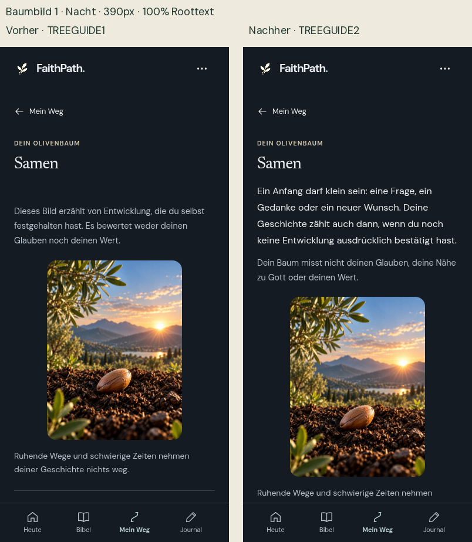

# FaithPath Phase 6D – Olivenbaum: Abschlussprüfung

Stand: 18.10.2026. Ausschließlich Branch `feature/tree-seven-stages-meaning-20261017`.

## Ergebnis

Der bestehende Baum-Leitfaden wurde fortgesetzt, gezielt korrigiert und als separater QA-Kandidat geprüft. Die sieben vorhandenen Bedeutungstexte, Bilder, Schwellen und persönlichen Datenmodelle bleiben erhalten. Es gab keinen Merge, kein Deployment und keine Änderung am MOBILE2-Branch oder an main.

**GO für die isolierte Geräteabnahme. Keine Produktionsfreigabe.** Physisches iPhone, Safari, installierte iPhone-PWA und VoiceOver bleiben OFFEN. Die früheren Gerätegates von MOBILE2 und den vorangehenden Phasen sind dadurch ebenfalls nicht erledigt.

| Prüfung | Ergebnis |
|---|---|
| Vollständige Unit-Suite | BESTANDEN: 197 Tests, 0 Fehler, 0 übersprungen |
| Ursprüngliche relevante Browserprogramme | BESTANDEN: 15 Programme, jeweils Exit 0 |
| Sieben Bilder × vier Themes × zwei mobile Größen × zwei Textgrößen | BESTANDEN: 112 Layoutfälle |
| Native Tastatur, axe und zusätzliche Größen | BESTANDEN: 16 Fälle, einschließlich vier Offline-Fällen |
| MOBILE2 → TREEGUIDE2 auf derselben lokalen HTTPS-Origin | BESTANDEN: fünf tatsächliche Update-Prüfungen |
| Geschützte Inhalte, Speicherung und Fortschrittsregeln | BESTANDEN; Einzelbelege unten |
| Zweifacher Build | BESTANDEN: alle 367 Dateien bytegleich |
| Unabhängiges Review | Keine Critical-/Important-/Minor-Befunde reproduziert |
| Bestehender langer Stufenname bei 320px/200% | P3-Restbefund, bereits im Ausgangsbuild; keine neue Regression |
| Echtes iPhone/Safari/VoiceOver | OFFEN |

## Exakt geprüfter Versionsstand

| Nachweis | Wert |
|---|---|
| Ausgangscommit des vorhandenen Baum-Moduls | `491acf33c409be37781073d2d831c16c56192241` |
| Ausgangsbuild | `FP4-20261017-G-STABLE1-UIUX6D-TREEGUIDE1` |
| Ausgangs-Buildhash | `3842e5fc5b8d920257b3b29bb69c92a8ddc7f84b2195eb2882b469917eef39ed` |
| Geprüfter Appcommit | `2b48ae037deeb05100d550522623ecf75ff07224` |
| Neuer Build | `FP4-20261018-G-STABLE1-UIUX6D-TREEGUIDE2` |
| Neuer Buildhash | `150c015ebb36ea50b1e4c3379eca583f3cf5e73ca963de56ea6f0910aebf5598` |
| Netlify-QA-ZIP SHA-256 | `14be65dce50336df6c1f41c8549e0f9d3551cd94171460e972df5fde2232aa9a` |
| Unveränderter Content-Hash | `8630cf25034cbd8ee28060b2318addc25d26611317439d08ac2fa5cae938e309` |
| MOBILE2-Kontrollbuild für den Update-Test | `FP4-20261017-G-STABLE1-UIUX6B-MOBILE2` |
| MOBILE2-Buildhash | `d1fd4804aaaeefc19b018776714b9607d92d404ab733b0e1a0619a6f083c6db0` |

Der Baum-Branch enthält MOBILE2 als Vorfahren. Zu Beginn waren nur die fünf beauftragten Dateien gegenüber MOBILE2 verändert. Die Prüfung verwendet echte lokale Builds; sie behauptet keinen neuen Netlify-Livestand. Ein späterer reiner QA-/Dokumentationscommit enthält dieselben App-Dateien; dessen SHA steht separat im Liefernachweis.

## Bestätigter Fehler und Korrektur

**D1 – Die aktuelle Bedeutung war zu spät sichtbar, P2.** Ursache war die Reihenfolge in `renderTreeJourney`: Erst kamen Grafik und Wegverknüpfungen, danach die aktuelle Erklärung. Im unveränderten Nachtbuild bei 390×844 begann der Bedeutungstext für Samen bei y1040 und für den fruchttragenden Baum bei y1218. Die untere Navigation begann bereits bei y777.

Der bestehende reine Renderer wurde aufgeteilt: `renderTreeStageMeaning(level)` liefert die aktuelle Bedeutung neben der Überschrift; `renderTreeStageGuide(level)` behält die aufklappbaren Übersichten unter der Grafik. Die doppelte aktuelle Beschreibung und zweite Stufenüberschrift entfallen. Baumbezogene Abstände wurden im bestehenden CSS-Modul angepasst. Im selben Vergleich liegt die aktuelle Bedeutung nun bei y232–344 und ist vor der Grafik vollständig lesbar. Die Grafik behält ihre Größe und braucht bei größeren Bildern weiterhin Scrollraum.

Zwei Node-Kriterien und zwei gezielte Browserzustände wurden vor der Änderung rot und danach grün. Die sechs Leitfaden-Unit-Tests und anschließend die vollständigen 197 Tests bestanden. Die breitere Matrix bestätigte die Reihenfolge für alle sieben Stufen.

**D2 – Biblische Kontexte präzisiert.** Die bisherigen Aussagen wurden nicht als nachweislich falsche Zitate eingestuft. Ihre knappen Referenzen ließen jedoch den Kontext offen. Die Erklärung benennt jetzt Vertrauen auf Gottes Güte/Treue, Vertrauen in Dürrezeiten und die Frucht des Geistes ausdrücklich. Die aktuelle Ansicht sagt außerdem klar, dass der Baum weder Glauben noch Nähe zu Gott oder menschlichen Wert misst. Kein Bibeltext und keiner der sieben vorhandenen Bedeutungstexte wurde dafür geändert.

Geänderte App-Dateien gegenüber dem beauftragten Ausgangsstand: `src/tree-stage-guide.js`, `src/tree-view.js`, ausschließlich Baumregeln in `src/verbunden/personal.css` und `src/version.js`. Keine neue Abhängigkeit und kein neues Speicherverfahren.

## Geprüfter Nutzerablauf mit Bildern

1. **Mein Weg → Olivenbaum öffnen – BESTANDEN.** Die bestehenden Links bleiben erreichbar; aktive und archivierte Wege behalten ihre Zuordnungen. Originale Baum-/Wege-Regressionsprogramme prüfen die echten Ziele und mindestens 44px große Zweig-Touchflächen.
2. **Aktuelles Bild verstehen – BESTANDEN.** Stufenname und unveränderter persönlicher Bedeutungstext stehen vor der Grafik. [Vergleich Samen](Vergleich_Stufe1_390_100.png), [Vergleich fruchttragender Baum](Vergleich_Stufe7_390_100.png).
3. **Alle sieben Bilder aufklappen – BESTANDEN.** Native Details/Summary-Bedienung per Enter und Leertaste; sieben Namen und Erklärungen, genau eine aktuelle Darstellung. [Aufgeklappte Übersicht](screenshots/after/stage-7-night-390-100-guide.png).
4. **„Warum genau sieben?“ lesen – BESTANDEN.** Gestaltungsentscheidung, Bibelkontext und Grenzen der Darstellung bleiben freiwillig erreichbar. [Biblischer Kontext](screenshots/after/stage-7-night-390-100-context.png).
5. **Zum echten Weg zurückkehren und offline wieder öffnen – BESTANDEN.** Bestehende Weg-, Journal- und Rückblickregressionen bleiben grün; der neue Leitfaden funktioniert nach einem tatsächlichen Worker-Update offline. [Offline nach Update](screenshots/update/updated-tree-offline.png).



Die [interaktive Vergleichsgalerie](screenshots/index.html) enthält Original-PNGs und eine repräsentative Auswahl. Das separate Screenshot-ZIP enthält die vollständigen Aufnahmen. Die 473 PNGs sind keine 473 unterschiedlichen Nutzerzustände: enthalten sind 112 Layoutfälle mit je drei Aufnahmen, 32 Vorherfälle mit je drei Aufnahmen, weitere Kontrollbilder, Übersichtstafeln und Vergleichsbilder.

## Die sieben bestehenden Bilder und ihre Regeln

| Bild | Ausdrücklich dokumentierte Entwicklungen | Bedeutung der unveränderten Beschreibung |
|---|---:|---|
| Samen | 0 | Ein kleiner Anfang zählt auch ohne bestätigte Entwicklung. |
| Keimling | 1 | Eine erste persönliche Veränderung wurde bewusst festgehalten. |
| Junger Olivenbaum | 2 | Weitere Erfahrungen verbinden sich; offene Fragen und Umwege bleiben möglich. |
| Wachsender Olivenbaum | 3–4 | Langsames, ungerades Wachsen ist kein Wettlauf. |
| Starker Olivenbaum | 5–6 | Halt und Ausdauer sind ein Bild; niemand muss immer stark sein. |
| Erste Früchte | 7–9 | Liebe, Geduld und Versöhnung werden nicht von FaithPath bewertet. |
| Fruchttragender Olivenbaum | ab 10 | Weder Auszeichnung für perfekten Glauben noch Ende des persönlichen Weges. |

Das sind bestehende Darstellungsgrenzen und keine geistlichen Sollwerte. `developmentCount` und `treeLevel` sind bytegleich mit MOBILE2. Gezählt werden vorhandene Meilensteine sowie bestätigte, keinem Weg mehr zugeordnete Rückblicke. Archivierung und bewahrte Entwicklungen nach einer Weglöschung folgen weiterhin der alten Regel. Es gibt keine achte Stufe.

Die neue Prüfung verifiziert die Grenzen für alle Zahlen von 0 bis 100. Zusätzliche Lesereignisse, Quizabschlüsse und erledigte Schritte ändern die Stufe nicht. Der Leitfaden besitzt keine Schreibzugriffe und ändert die Eingabedaten auch beim Rendern nicht.

## Biblische Prüfung

Gelesen wurden die tatsächlich gespeicherten Texte beider Übersetzungen: Psalm 52 vollständig, Jeremia 17,1–10 und Galater 5,13–26. [Quellbeleg mit Versen und sechs Dateihashes](evidence/theology-sources.json).

| Bezug | Passender Kontext und Grenze |
|---|---|
| Psalm 52 | Der Ölbaum im Haus Gottes steht im Kontrast zu schädigender Selbstsicherheit und Vertrauen auf Reichtum; der Beter vertraut auf Gottes Güte/Treue. Daraus folgt keine App-Leistungswertung. |
| Jeremia 17,7–8 | Vertrauen auf den Herrn wird mit einem Baum am Wasser verglichen, der auch in Hitze und Dürre versorgt bleibt. Der Text schreibt weder einen Olivenbaum noch sieben Entwicklungsbilder vor. |
| Galater 5,22–23 | Frucht des Geistes im Kontext von Freiheit, Liebe und gemeinschaftlichem Leben. Diese Frucht wird nicht durch App-Aktivität verdient, gezählt oder bewertet. |

Die lokalen Psalm-52-Dateien führen das Ölbaum-Bild beide als Vers 8. Bei Galater verteilt OTB die Fruchtliste auf 22–23; Luther 1912 enthält die Liste in 22 und den abschließenden Gesetzessatz in 23. Der Leitfaden verwendet deshalb passende Kontextangaben und eigene Paraphrasen, keine angeblich identischen Direktzitate. An den Übersetzungen oder ihrer Verssegmentierung wurde nichts verändert.

Sieben ist hier eine gestalterische Wahl. Die Erklärung einer verbreiteten biblischen Zahlensymbolik wird ausdrücklich von einer verbindlichen Entwicklungsleiter getrennt. „Starker Olivenbaum“ bleibt ein bestehender Bildname; seine Erklärung weist die Erwartung zurück, immer stark sein zu müssen.

## Tatsächlich ausgeführte Qualitätssicherung

Umgebung: Node 24.19.0, Python 3.12.14, Chromium 151.0.7922.173 auf Linux; Playwright aus den unveränderten Projektabhängigkeiten. Kein WebKit-/Safari- oder physisches iPhone-Testsystem.

- `npm test`: Ausgangsstand 195/195, korrigierter Stand 197/197; keine übersprungenen Tests. Der Content-Pretest enthält unveränderte vorhandene Hinweise zu Vollkapitelreferenzen; diese werden nicht als neue Fehler oder als redaktionell behoben ausgegeben.
- `npm run build` mit separatem `FAITHPATH_OUT`: zweimal aus dem exakten Appcommit. `verify-preview-build.mjs` bestätigt alle 367 Dateien und denselben Buildhash.
- `tests/uiux6d/capture.mjs`: 32 frische Vorherfälle und 112 endgültige Nachherfälle. 320×568 und 390×844, vier Themes, 100/200% Roottext, alle sieben Bilder. Geprüft werden Reihenfolge, normaler erster Viewport, Umbruch, Textgröße und sieben Einträge mit genau einer aktuellen Markierung. Alle Bilder verwenden die originale CSP und den aktiven Worker.
- `tests/uiux6d/acceptance.mjs`: 16 Tastatur-/axe-Fälle bei 320/200%, 390/100%, 430/100% und 1440/100%, jeweils alle vier Themes; vier zusätzliche Offline-Reloads. Axe benötigt in diesem getrennten Diagnoselauf einen CSP-Bypass. Daraus folgt keine vollständige WCAG- oder VoiceOver-Zertifizierung.
- `tests/uiux6d/update.mjs`: tatsächlicher MOBILE2→TREEGUIDE2-Übergang auf einer isolierten Loopback-HTTPS-Origin mit bewusster Aktivierung, unveränderten Speicherbytes, neuem Leitfaden offline, lokalen Fonts und beiden Psalmtexten. Leseort und Lesereignisse dürfen beim anschließenden Bibellesen wie bisher fortgeschrieben werden; Entwicklungssumme, persönliche Inhalte, Entwurf und Sicherung bleiben unverändert.
- `tests/uiux6b/backup-lifecycle.mjs`: bestehende Prüfung gegen einen nach Navigation verspätet zurückkehrenden Dateiimport, unveränderte Haupt-/Entwurfs-/Sicherungsbytes.
- Unabhängiger Reviewer: eigene 197-Tests-Suite, Quell-/Bibelhashvergleich und vier zusätzliche Browserfälle. [Reviewbericht](evidence/review/independent-review.md).
- Lokale Liefergalerien: 16 zusätzliche Browserprüfungen für Filter, Originalbilder, fehlende Vorherzustände und Tastatur; keine JavaScript-/HTTP-Fehler. [Galeriebeleg](evidence/gallery/results.json).

Die ursprüngliche Regression lief über `tests/uiux6b/run-regression.py`, mit dem endgültigen Build als `FAITHPATH_TEST_ROOT` und eigenen Ausgabeordnern. Tatsächlich ausgewählt und jeweils mit Exit 0 abgeschlossen:

| Programm | Originaltreiber |
|---|---|
| core | browser.mjs |
| core-axe | core-depth-accessibility.mjs |
| continuity | continuity-browser.mjs |
| branches | tree-branch-visual-browser.mjs |
| overview | phase3-overview-browser.mjs |
| detail | phase3-detail-browser.mjs |
| tree | phase3-tree-browser.mjs |
| reviews-original | phase3-review-browser.mjs |
| phase3-stress | phase3-stress.mjs |
| journal | phase5-journal-browser.mjs |
| reviews | phase5-reviews-browser.mjs |
| backup | phase5-backup-browser.mjs |
| backup-races | phase5-backup-races-browser.mjs |
| backup-dialogs | phase5-backup-dialogs-browser.mjs |
| integration | uiux45-integration-browser.mjs |

Die Originaltreiber behalten ihre Geschäfts-/Datenassertions. Diese 15 Programme sind keine Behauptung, sämtliche historischen Repositoryskripte erneut ausgeführt zu haben. Alle Ausgänge sind an Appcommit und Buildhash gebunden: [QA_SUMMARY.json](QA_SUMMARY.json), [Originalprogramm-Exits](evidence/regression/exits.json).

## Datenintegrität und unveränderte MOBILE2-Grundlage

175 geschützte Inhalts-/Kern-Dateien sind bytegleich, einschließlich Store, Domain, Importvalidierung, Journaltransaktionen, Rückblickkontext, Bibelreise, Themes und Worker-Vorlage. Eine separate Quellprüfung bestätigt 63 unveränderte Bestandsdateien; diese Mengen überschneiden sich teilweise. Der historische Quellselektor der Baumgeschichte und der komplette bisherige Abschnitt von `personal.css` vor dem neuen Baum-Modul sind unverändert.

Alle sieben ursprünglichen Bedeutungsstrings sind exakt gleich. Bilder, Namensliste, Fragen, Bibeltexte und Inhalts-IDs wurden nicht verändert. Der statische Funktionsvergleich behält 34 Routenfamilien und 79 Aktionsnamen. Backups werden weiterhin mit dem bisherigen Schema und den bisherigen Transaktionen geprüft, bewusst bestätigt, wiederhergestellt und rücknehmbar gehalten. Es gibt keine neue Migration.

Die automatisierten Browserprofile enthalten nur synthetische Daten. Persönliche Bestandsdaten wurden weder gelesen noch verändert. Die früheren MOBILE2-Berichte, sein eingefrorener Build und das historische `dist/` bleiben unberührt. Belege: [175-Dateien-Vergleich](evidence/preservation/results.json), [Modul- und Schwellenvergleich](evidence/module-preservation.json).

## Visuelle Prüfung und verbleibende Grenzen

Acht Übersichtstafeln wurden tatsächlich angesehen: alle sieben Bilder bei 390px/100% und 320px/200%, in allen vier Themes. Zusätzlich wurden Originalbilder des Seitenanfangs, der aufgeklappten Übersicht und des biblischen Kontexts sowie die unabhängigen Kontrollbilder geprüft. [Galerie](screenshots/index.html).

Bei normaler Schrift sind Bedeutung, ruhige Typografie und bestehende Naturbilder zusammen sichtbar. Die beiden Übersichten bleiben zugeklappt und verdrängen den Baum nicht. Bei 200% bleibt vertikales Scrollen erforderlich; ganze Erklärungen werden nicht auf einen Bildschirm gezwungen oder durch winzige Schrift beziehungsweise neues Abschneiden kaschiert.

**Bekannter P3-Bestandsbefund:** Bei 320px/200% trennt die unveränderte bestehende Titeltypografie „Fruchttragender“ mitten im Wort. Dieselbe Trennung ist in den frischen Vorherbildern des Ausgangsbranches belegt. Sie ist vollständig lesbar, erzeugt keinen horizontalen Verlust, wirkt aber weniger ruhig. Im Auftrag wurden nur Fehler des neuen Leitfadens korrigiert; ein weiterer Umbau der älteren MOBILE2-Titelhierarchie wurde nicht vorgenommen. [Vorher/Nachher bei großer Schrift](Vergleich_Stufe7_320_200.png).

Echtes Safari-Text-Autosizing, Safari-Seitenzoom, dynamische iOS-Schrift, Browserleisten, installierte PWA, Bildschirmtastatur und VoiceOver bleiben OFFEN. Roottext-Vergrößerung und Chromium-ARIA-Snapshots sind dafür kein Ersatz. Die [Geräteanleitung](IPHONE_ABNAHME.md) nennt die verbleibenden Schritte.

## Nicht als Produktfehler gewertete Testversuche

Der erste Build scheiterte am Sandbox-Fehler `spawnSync git EPERM`; dieselben Quellen bauten mit dem für Kindprozesse geeigneten Runtime-Zugriff. Es wurde kein Buildcode dafür geändert.

Der erste lokale HTTPS-Updatelauf erreichte schon mit dem unveränderten MOBILE2 keinen Worker: Die Seitenoption `ignoreHTTPSErrors` reichte für Chromiums Worker-Zertifikatsprüfung nicht. Eine isolierte Gegenprobe mit identischem Zertifikat und Ausgangsbuild zeigte den SSL-Fehler ohne Browseroption und einen aktiven, offline bereiten Worker mit der gezielten Testbrowseroption. Anschließend bestanden alle fünf wirklichen Updateprüfungen. Die Zertifikatsausnahme gilt ausschließlich für diesen kurzlebigen Loopback-Testbrowser, nicht für die App oder ein persönliches Profil. Fehlversuch und Probe sind erhalten und werden nicht als PASS-Belege gezählt: [Versuche](evidence/attempts-summary.json), [TLS-Probe](evidence/tls-probe.json).

## Dateien und reproduzierbarer Build

- `FaithPath_UIUX6D_TREEGUIDE2_Netlify_QA.zip`: vollständiger statischer Build, index.html im ZIP-Wurzelverzeichnis, beide Offline-Bibeln, Fonts, Fragen, Bilder und Worker. Kein Deployment.
- `FaithPath_UIUX6D_TREEGUIDE2_Bericht_QA.zip`: dieser Bericht, Geräteanleitung, Originalprotokolle, maschinenlesbare Nachweise und repräsentative lokale Galerie.
- `FaithPath_UIUX6D_TREEGUIDE2_Screenshots.zip`: vollständige 473 PNGs und lokale Vergleichsgalerie.
- Separate Lieferquittung und SHA-256-Liste benennen die endgültigen Archivprüfsummen und den QA-Liefercommit. ZIP-Hash und Build-Dateimap-Hash sind unterschiedliche Verfahren.

Der Buildhash ist wie bisher SHA-256 der geordneten Pfad-zu-Dateihash-Map als JSON. Im exakten Appquellstand beziehungsweise bei nachgewiesen identischen App-Dateien eines späteren QA-Commits:

```sh
npm test
FAITHPATH_BUILD_BRANCH=feature/tree-seven-stages-meaning-20261017 FAITHPATH_BUILD_COMMIT=2b48ae037deeb05100d550522623ecf75ff07224 FAITHPATH_OUT=qa-output/uiux6d/repro npm run build
node scripts/verify-preview-build.mjs qa-output/uiux6d/repro
```

Browserprüfungen benötigen lokale Server und ausschließlich synthetische Profile. Der Update-Treiber benötigt zusätzlich den exakt gehashten MOBILE2-Build; die bestehende Kontinuitätsprüfung verwendet den eingefrorenen UIUX45-Kontrollstand auf Port 4450. Alle tatsächlichen Befehle, Pfade und Grenzen stehen in den mitgelieferten Treibern und Rohprotokollen.

Eine Rücknahme wäre ein neuer kontrollierter Präsentations-Revert oder der unveränderte MOBILE2-Quellstand. Persönliche Daten dürfen dafür niemals zurückgesetzt werden. Es wurde keine automatische Rücknahme, Veröffentlichung oder Zusammenführung ausgeführt.

**Empfehlung:** Diesen getrennten Kandidaten für die physische Geräteabnahme freigeben. Erst nach dokumentiertem Geräte-Gate über eine Veröffentlichung entscheiden.
